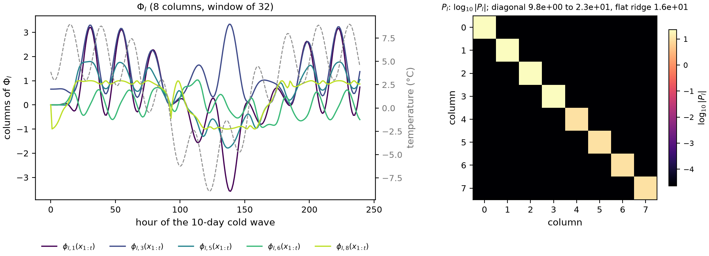

# The Bispectrum Effect: Higher-Order Spectral Analysis & Quadratic Phase Coupling

**Navigation:**
  * **Theory Introduction:** [See the Intro](../../THEORY.md)
  * **Code Architecture:** [See BISPECTRUM.md](../../architecture/spectrum/BISPECTRUM.md)

## Foundational Theory: Why Second-Order Spectra Fall Short

Standard Fourier and autocorrelation analyses rely exclusively on the second-order power spectral density $S(\omega) = \mathbb{E}[|X(\omega)|^2]$ (Wiener–Khinchin theorem). Consequently, second-order methods are completely **phase-blind**: they cannot distinguish a linear Gaussian process from a non-linear, phase-coupled, asymmetric, heavy-tailed process with identical power spectrum {cite:p}`brillinger1965introduction, nikias1993higher`.

In electricity grid losses, volatile wholesale power prices, and industrial loads, non-linear physical interactions generate **Quadratic Phase Coupling (QPC)**:

$$\omega_3 = \omega_1 + \omega_2, \qquad \phi_3 = \phi_1 + \phi_2$$

This coupling produces non-zero third-order cumulants, skewness, and extreme asymmetric spikes that break Gaussian and Student-$t$ parametric models. By introducing the **Bispectrum** and **Bicoherence** {cite:p}`brillinger1965introduction, hinich1982testing, nikias1993higher`, TAM detects phase coupling and materializes an explicit quadratic phase-coupled Primal feature map $\Phi_{\text{bispec}}$.

## 1. Third-Order Cumulant and the Bispectrum

For a zero-mean stationary stochastic process $\{x_t\}$, the third-order cumulant sequence is the two-lag skewness tensor:

$$C_3(\tau_1, \tau_2) = \operatorname{cum}(x_t,\, x_{t+\tau_1},\, x_{t+\tau_2}) = \mathbb{E}\big[x_t\, x_{t+\tau_1}\, x_{t+\tau_2}\big]$$

For any Gaussian process (or any symmetric linear process), $C_3(\tau_1, \tau_2) \equiv 0$ identically. The **Bispectrum** $B(\omega_1, \omega_2) \in \mathbb{C}$ is the 2D Fourier transform of $C_3(\tau_1, \tau_2)$ {cite:p}`brillinger1965introduction, nikias1993higher`:

$$B(\omega_1, \omega_2) = \sum_{\tau_1=-\infty}^{\infty} \sum_{\tau_2=-\infty}^{\infty} C_3(\tau_1, \tau_2)\, e^{-i(\omega_1 \tau_1 + \omega_2 \tau_2)}$$

In the frequency domain, with discrete Fourier transform $X(\omega) = \sum_{t=0}^{N-1} x_t e^{-i\omega t}$, the bispectrum measures the cross-correlation across closed frequency triads $\omega_1 + \omega_2 + \omega_3 = 0$ (i.e. $\omega_3 = -(\omega_1 + \omega_2)$):

$$\hat{B}(k_1, k_2) = \frac{1}{M_{\text{seg}}} \sum_{m=1}^{M_{\text{seg}}} X^{(m)}(k_1)\, X^{(m)}(k_2)\, \big(X^{(m)}(k_1 + k_2)\big)^*$$

averaged across $M_{\text{seg}}$ Welch overlapping segments in the principal non-redundant triangular domain:

$$\Omega = \big\{(k_1, k_2) \in \mathbb{N}^2 \;\big|\; 1 \le k_2 \le k_1, \; k_1 + k_2 \le \frac{N}{2}\big\}$$

## 2. Normalized Bicoherence & Hinich Tests

To eliminate amplitude dependence on the marginal power spectrum $P(k) = \mathbb{E}[|X(k)|^2]$, the squared **Bicoherence** $b^2(k_1, k_2) \in [0, 1]$ is normalized via the Kim & Powers / Haubrich formulation {cite:p}`kim1979digital, hinich1982testing`:

$$b^2(k_1, k_2) = \frac{\big|\hat{B}(k_1, k_2)\big|^2}{\left( \frac{1}{M_{\text{seg}}} \sum_{m=1}^{M_{\text{seg}}} |X^{(m)}(k_1) X^{(m)}(k_2)|^2 \right) \left( \frac{1}{M_{\text{seg}}} \sum_{m=1}^{M_{\text{seg}}} |X^{(m)}(k_1 + k_2)|^2 \right) + \varepsilon}$$

By the Cauchy–Schwarz inequality, $0 \le b^2(k_1, k_2) \le 1$ strictly:
- Under the null hypothesis of a purely linear Gaussian process, $2 M_{\text{seg}} b^2(k_1, k_2) \xrightarrow{d} \chi^2_2$ asymptotically (**Hinich Gaussianity Test**, {cite:p}`hinich1982testing`).
- Under a linear non-Gaussian process, $b^2(k_1, k_2)$ is approximately constant across frequencies. Spatial peaks in $b^2(k_1, k_2)$ prove genuine **Quadratic Phase Coupling (QPC)**:

$$x_t \supset A_1 \cos(\omega_1 t + \phi_1) + A_2 \cos(\omega_2 t + \phi_2) + A_{12} \cos\big((\omega_1 + \omega_2)t + \phi_1 + \phi_2\big)$$

## 3. Primal Feature Map ($\Phi_{\text{bispec}}$)

For each selected triad $j = (k_{1,j}, k_{2,j})$ with $k_{3,j} = k_{1,j} + k_{2,j}$ and $\omega_i = 2\pi k_i / n_{\text{fft}}$, the causal short-time Fourier components over the last $n_{\text{fft}}$ samples are

$$z_i(t) = \sum_{s=0}^{n_{\text{fft}}-1} h_s\, x(t-s)\, e^{+\mathrm{i}\omega_i s},$$

with the Hann window $h_s = \tfrac12 - \tfrac12\cos\frac{2\pi (s + 1/2)}{n_{\text{fft}}}$; the phase is taken in the window coordinate $s$, so it does not depend on the absolute index $t$. The bispectral product

$$B_j(t) = z_1(t)\, z_2(t)\, \overline{z_3(t)}$$

is free of the absolute time: the phase factors $e^{-\mathrm{i}(\omega_1 + \omega_2 - \omega_3)t}$ cancel because $\omega_3 = \omega_1 + \omega_2$, so $B_j(t)$ only depends on the samples inside the window. When the three components are phase locked, $\varphi_1 + \varphi_2 - \varphi_3$ (the biphase) is constant and $B_j$ keeps a constant phase; when they are not, the phase rotates and $B_j$ averages to zero {cite:p}`kim1979digital, hinich1982testing`.

The four columns of the triad are

$$\Big[\; \frac{\operatorname{Re} B_j}{s_j},\;\; \frac{\operatorname{Im} B_j}{s_j},\;\; \frac{|z_1 z_2|}{s_{a,j}},\;\; \cos(\varphi_1 + \varphi_2 - \varphi_3) = \frac{\operatorname{Re} B_j}{|z_1 z_2|\,|z_3| + \varepsilon_j} \;\Big],$$

with $s_j$ and $s_{a,j}$ the training medians of $|B_j|$ and $|z_1 z_2|$ and $\varepsilon_j = 10^{-12}$ times the training median of $|z_1 z_2|\,|z_3|$, all frozen when the effect is initialized. Because the pairs $(k_1, k_2)$ are distinct, the four columns of a triad differ from those of every other triad.

## 4. Sobolev-Bicoherence Penalty Matrix ($P_{\text{bispec}}$)

The penalty matrix $P_{\text{bispec}}$ weights each triad by its total bi-frequency Sobolev roughness and inversely by its empirical bicoherence significance:

$$P_{\text{bispec}} = \operatorname{diag}\!\left( \lambda_p \cdot \frac{1 + (\omega_{1,j}^2 + \omega_{2,j}^2 + (\omega_{1,j}+\omega_{2,j})^2)^s}{\max\big(b^2_j,\, \varepsilon_b\big)} \right)_{j=1}^K \otimes I_4$$

- **High-frequency suppression**: the Sobolev numerator regularizes rapid oscillatory noise.
- **Empirical bicoherence weighting**: triads with spurious, low bicoherence ($b^2 \to 0$) receive large penalty weights and shrink to zero, while validated quadratic couplings ($b^2 \to 1$) are retained. The bicoherence is estimated once, on the segments of every training group (a segment never spans two groups).
- **Strict positive definiteness**: every diagonal element is positive, so $P_{\text{bispec}} \succ 0$.

## 5. Causality and state continuation

Every component is a causal window ending at the current step: the features of step $t$ never use a later value. The state is the last $n_{\text{fft}} - 1$ samples of every group, `{"hist": (B, n_fft - 1, 1)}`; without one the first sample is replicated. The effect reads one column.

## Conditioning on smooth series

The columns of the bispectral product of a very smooth series (a few sinusoids with little noise) are nearly linearly dependent: the Gram matrix of the design is badly conditioned, and the penalized solution is then sensitive to small differences between the series used to fit and a later one unless the penalty weight is large enough to control the near-null directions of the design. The weight of the penalty, not a rescaling of the columns, is the quantity that restores a stable solution; it is chosen by the same criteria as for any other term.

## Chunk equivalence

The features of a series computed in one pass over it equal the features computed in two chunks when the second chunk starts from the terminal state of the first. Three mechanisms carry that state, and this effect uses a **window history** (the last rows of every group, which complete the windows of the next chunk) and **frozen training statistics** (constants estimated once on the training period, which a later chunk does not update). Because the state is exactly what a later row reads from the past, a forecast can continue a fitted series one chunk at a time without refitting or recomputing the past.

## What is new here

The bispectrum, the bicoherence and the Hinich test are those of the cited papers. What this effect adds:

- the **phase-coupling features used as regressors of an additive model**: the real and imaginary parts of the causal bispectral product of a triad, its modulus input and the cosine of the biphase are columns of a penalized term, so a load whose daily and weekly components are phase locked can be regressed on that locking;
- the **time-free form of the product**, which depends only on the samples inside the window, so that a forecast that continues the training period needs only the last $n_{\text{fft}} - 1$ samples;
- the **bicoherence-weighted Sobolev penalty** that shrinks the triads without significant coupling.

The `hinich_bispectrum_test` function of the diagnostics is unchanged and is the way to choose the triads.

## References

- Brillinger, David R. (1965). *An Introduction to Polyspectra*. The Annals of Mathematical Statistics. `brillinger1965introduction`
- Kim, Young C, Powers, Edward J (1979). *Digital bispectral analysis and its applications to nonlinear wave interactions*. IEEE Transactions on Plasma Science. `kim1979digital`
- Hinich, Melvin J (1982). *Testing for Gaussianity and linearity of a stationary time series*. Journal of Time Series Analysis. `hinich1982testing`
- Wood, Simon N (2017). *Generalized additive models: an introduction with R*. chapman and hall/CRC. `wood2017generalized`
