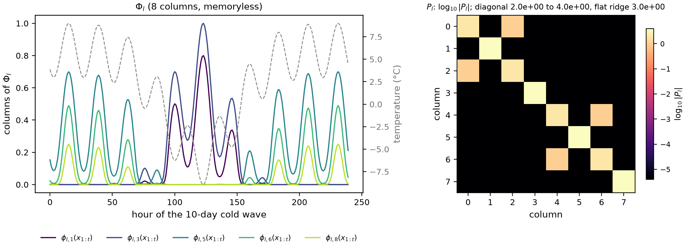

# Smooth Degree-Day Hinges

**Navigation:**
  * **Theory introduction:** [See the Intro](../../THEORY.md)
  * **Related code architecture:** [See the Code Architecture](../../architecture/spectrum/DEGREE_DAY.md)

## Smooth Softplus Heating & Cooling Degree-Day Hinges

Piecewise-linear heating and cooling degree-day thresholds $\max(0, u_m - T_t)$ and $\max(0, T_t - v_j)$ have discontinuous derivatives at the balance points $u_m, v_j$. Replacing the hard hinge with a $C^\infty$ softplus with sharpness $\beta > 0$ yields:

$$\operatorname{HDD}_\beta(T_t; u_m) = \frac{1}{\beta} \ln\!\Big(1 + \exp\big(\beta (u_m - T_t)\big)\Big), \qquad \operatorname{CDD}_\beta(T_t; v_j) = \frac{1}{\beta} \ln\!\Big(1 + \exp\big(\beta (T_t - v_j)\big)\Big)$$

Optionally, quadratic saturation terms $\operatorname{HDD}_\beta^2$ and $\operatorname{CDD}_\beta^2$ capture extreme cold or heat demand curvature under the penalty given below.

## Penalty

The columns are the hinges $\operatorname{HDD}_\beta(\cdot; u_m)$ in ascending order of $u_m$, then the hinges $\operatorname{CDD}_\beta(\cdot; v_j)$ in ascending order of $v_j$, each followed by its square when `quad=True`. A squared hinge grows faster than a hinge, so it weighs four times more. The hinges of one family, ordered by threshold, are coupled by a first difference, which prefers slopes that change slowly from one threshold to the next:

$$P_{\text{dd}} = \lambda\Big(\operatorname{diag}(w) + D_1^\top D_1\big|_{\text{heating hinges}} + D_1^\top D_1\big|_{\text{cooling hinges}}\Big), \qquad w = 1 \text{ (hinge)},\; 4 \text{ (squared hinge)}.$$

With a single threshold per side there is no coupling and the penalty is diagonal. The two families never mix.

## Causality

The hinges are a pointwise function of the temperature: no memory, no state, no interaction between groups.

## What is new here

Degree-day variables are a standard device of load forecasting {cite:p}`goude2014local`. What this effect adds:

- the **softplus hinge with a sharpness parameter** {cite:p}`dugas2001incorporating`, differentiable at the balance point, so that the fitted response has no kink;
- a **family-wise difference penalty** coupling neighbouring thresholds, so that a dictionary of several thresholds behaves like one smooth heating curve and one smooth cooling curve;
- the **quadratic hinges weighed by four**, which keeps the curvature terms from taking over at the extremes of temperature.

The token `smooth_hinge` is the same effect under its generic name.

## References

- Goude, Yannig, Nedellec, Raphael, Kong, Nicolas (2014). *Local short and middle term electricity load forecasting with semi-parametric additive models*. IEEE Transactions on Smart Grid. `goude2014local`
- Dugas, Charles et al. (2000). *Incorporating second-order functional knowledge for better option pricing*. Advances in Neural Information Processing Systems (NIPS). `dugas2001incorporating`
- Eilers, Paul HC, Marx, Brian D (1996). *Flexible smoothing with B-splines and penalties*. Statistical science. `eilers1996flexible`
