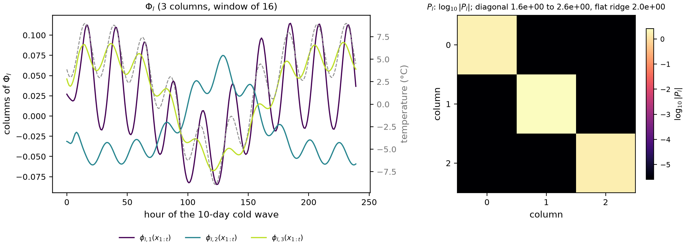

# Fourier Neural Operator

**Navigation:**
  * **Theory introduction:** [See the Intro](../../THEORY.md)
  * **Related code architecture:** [See the Code Architecture](../../architecture/spectrum/FNO.md)

## Fourier Neural Operator Basis

### Theoretical formulation
Following Li et al. ({cite:p}`li2021fourier`), an FNO layer transforms an input function $v(t)$ by combining a local linear transform with a non-local spectral convolution truncated at the lowest $k_{\max}$ Fourier modes:

$$u_m(t) = \operatorname{GELU}\Big( w_m v(t) + \mathcal{F}^{-1}\big( R_m(\omega) \cdot \mathcal{F}(v)(\omega) \big)(t) \Big)$$

where $R_m(\omega) \in \mathbb{C}$ are complex Fourier multiplier weights for $m = 1, \dots, \text{width}$.

### Discretization invariance
Because the spectral truncation threshold $k_{\max}$ is fixed in frequency space rather than grid space:
- The operator can be evaluated on a coarse mesh (e.g., $T = 128$) and evaluated zero-shot on fine meshes (e.g., $T = 512$) with negligible discrepancy ($< 0.01$).
- Regularization penalty measures spectral Sobolev roughness in operator space:

$$P_{\text{fno}} = \operatorname{diag}\Big( 1.0 + \sum_{k=1}^{k_{\max}} k^2 |R_{m, k}|^2 \Big)_{m=1}^{\text{width}} \cdot \lambda_p$$

---

## Causal form

With `causal=True` (the default) the spectral convolution is applied to the sliding window of the last $W$ values of each group (`window`), and the output of step $t$ is the last sample of the filtered window:

$$u_m(t) = \operatorname{GELU}\Big( w_m x_t + \big[\mathcal{F}^{-1}\big(R_m \cdot \mathcal{F}(x_{t-W+1:t})\big)\big]_{W} \Big),$$

so the effect is strictly causal. The state is the last $W - 1$ values of every group, `{"hist": (B, W - 1, 1)}`. With `causal=False` the transform acts on the whole pass of each group at once, which is the resolution-invariant form described above and has no state. The spectral weights $R_m$ and the local weights $w_m$ are drawn once from a seeded generator and are not trained: the model is linear in its coefficients.

## Chunk equivalence

The features of a series computed in one pass over it equal the features computed in two chunks when the second chunk starts from the terminal state of the first. Three mechanisms carry that state, and this effect uses a **window history** (the last rows of every group, which complete the windows of the next chunk) and **frozen training statistics** (constants estimated once on the training period, which a later chunk does not update). Because the state is exactly what a later row reads from the past, a forecast can continue a fitted series one chunk at a time without refitting or recomputing the past.

## What is new here

The Fourier neural operator and its resolution invariance are those of the cited papers {cite:p}`li2021fourier, kovachki2023neural`. What this effect adds:

- the **fixed random spectral operator as a feature map**: the `width` channels are the columns of an additive term solved in closed form, with a penalty that grows with the spectral energy of the multipliers at high modes;
- the **causal sliding-window form** of the operator, so that it can be used for forecasting and continued from the training period;
- the **choice of the window and of causality in the formula** (`window=`, `causal=`).

## References

- Li, Zongyi et al. (2021). *Fourier neural operator for parametric partial differential equations*. International Conference on Learning Representations (ICLR). `li2021fourier`
- Kovachki, Nikola et al. (2023). *Neural operator: Learning maps between function spaces with applications to PDEs*. Journal of Machine Learning Research. `kovachki2023neural`
- Wood, Simon N (2017). *Generalized additive models: an introduction with R*. chapman and hall/CRC. `wood2017generalized`
