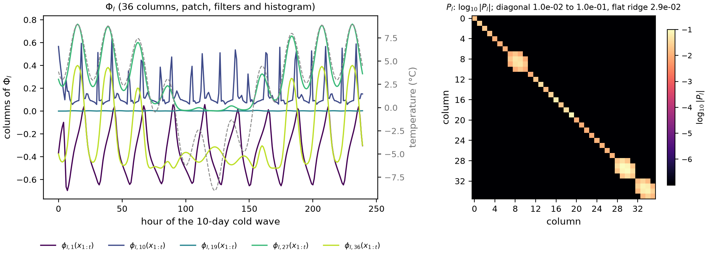

# Universal Foundation Basis

**Navigation:**
  * **Theory introduction:** [See the Intro](../../THEORY.md)
  * **Related code architecture:** [See the Code Architecture](../../architecture/spectrum/FOUNDATION.md)

## Closed-form foundation paradigm

Foundation-style forecasters combine a few structural ideas: patching of the series, reversible instance normalization, quantile tokenization of values and multi-scale filtering. The **Universal Foundation Basis** keeps the *structure* of those ideas and drops the trained network: every component is a fixed, weight-free basis of the input, the four blocks are concatenated, and the coefficients are solved by penalized weighted least squares like those of any other spectrum effect,

$$y = \Phi_{\text{foundation}}(X)\,\theta + \varepsilon, \qquad \big(\Phi^\top W \Phi + T\,P_{\text{foundation}}\big)\theta = \Phi^\top W y.$$

## Components

The four blocks are internal to `foundation` (they are not formula tokens).

1. **Patch basis** (see [PATCH_BASIS.md](PATCH_BASIS.md)): causal patch tokens with reversible instance statistics and Lévy-area tokens {cite:p}`nie2023time, kim2022reversible, rahimi2007random, lyons1998differential`.
2. **Quantile soft histogram**: the current value and the last $W$ values are standardized by the statistics of the window, and each is spread over $B$ triangular bins centred on the quantiles of a standard normal distribution; the columns are the average of the soft occupancy of the current value and of the window. It describes where the series stands in its own recent distribution (quantile binning of a scaled window {cite:p}`ansari2024chronos`).
3. **Multi-rate filterbank**: for each scale $s \in \{1, 4, 16, 64\}$ an exponential moving average $m_t = (1-a)m_{t-1} + a\,x_t$ with $a = 2/(s+1)$, the band $x_t - m_t$ and a bounded envelope of the band energy ($\tanh(\tfrac14 (x_t - m_t)^2)$ filtered by the same recurrence): $3S$ columns.
4. **Structural prior dictionary** (`StructuralPriorEffect`, the older name `PFNRidgeEffect` is kept as an alias): $n_{\text{struct}}$ fixed shape functions of the value in four families, saturating sigmoids, softplus hinges, skewed Gaussian pulses and rational heavy-tail components. The idea of a synthetic structural prior comes from prior-fitted networks {cite:p}`muller2022transformers`; here there is no network, only the dictionary.

## Penalty and penalty coordinates

$P_{\text{foundation}} = \operatorname{blkdiag}(\lambda_{\text{patch}}P_{\text{patch}}, \lambda_{\text{hist}}P_{\text{hist}}, \lambda_{\text{mrfb}}P_{\text{mrfb}}, \lambda_{\text{struct}}P_{\text{struct}})$. The patch block carries the roughness-weighted ridge of the patch basis; the histogram block a second-difference penalty on the bins; the filterbank a ridge growing with the scale ($\propto s^{1/2}$, 1, 1.5 and 2 times for the three kinds); the structural block a ridge on the sigmoids and hinges (weights 1 and 1.2) and a second-difference penalty on the pulses and on the heavy-tail components, which are ordered by their centre. The four weights are the penalty coordinates `patch`, `hist`, `mrfb`, `struct`; they start equal and GCV or REML tunes them separately.

Every second-difference penalty of the effect (the histogram bins, the pulses and the heavy-tail components) carries a small ridge: it is $D_2^\top D_2 + \varepsilon I$ with $\varepsilon = 10^{-6}$. The straight lines are the null space of $D_2$, so the ridge makes the penalty positive definite and keeps the log-determinant of the penalty, which the restricted marginal likelihood uses, defined.

## Causality and state continuation

Every block reads the current and past rows of its own group. The state carries the last rows of the patch and histogram windows and the two filter states per scale: `{"patch", "qhist", "ema", "env"}`. The filterbank recurrences run in linear time and memory in the length of the series.

## Chunk equivalence

The features of a series computed in one pass over it equal the features computed in two chunks when the second chunk starts from the terminal state of the first. Three mechanisms carry that state, and this effect uses a **window history** (the last rows of every group, which complete the windows of the next chunk), a **recurrence state** (the value of the filters or of the running sums at the last step) and **frozen training statistics** (constants estimated once on the training period, which a later chunk does not update). Because the state is exactly what a later row reads from the past, a forecast can continue a fitted series one chunk at a time without refitting or recomputing the past.

## What is new here

The ingredients are those of the cited papers. What this effect adds:

- the **combination of four closed-form components** (patch tokens, quantile soft histogram, multi-rate filterbank, structural dictionary) as one additive effect with one block-diagonal penalty;
- the **separate smoothing parameters** of the four blocks, tuned by the generalized cross-validation or REML criterion of the framework;
- the **filter-roughness and ordered-difference penalties** of the patch tokens and of the structural dictionary;
- the **weight-free construction**: no pre-training and no gradient step, so the fit is a single linear solve and is reproducible from a seed.

## References

- Nie, Yuqi et al. (2023). *A Time Series is Worth 64 Words: Long-term Forecasting with Transformers*. International Conference on Learning Representations (ICLR). `nie2023time`
- Kim, Taesung et al. (2022). *Reversible Instance Normalization for Accurate Time-Series Forecasting against Distribution Shift*. International Conference on Learning Representations (ICLR). `kim2022reversible`
- Rahimi, Ali, Recht, Benjamin (2007). *Random Features for Large-Scale Kernel Machines*. Advances in Neural Information Processing Systems. `rahimi2007random`
- Lyons, Terry J (1998). *Differential equations driven by rough signals*. Revista Matematica Iberoamericana. `lyons1998differential`
- Ansari, Abdul Fatir et al. (2024). *Chronos: Learning the Language of Time Series*. Transactions on Machine Learning Research. `ansari2024chronos`
- Muller, Samuel et al. (2022). *Transformers Can Do Bayesian Inference*. International Conference on Learning Representations (ICLR). `muller2022transformers`
