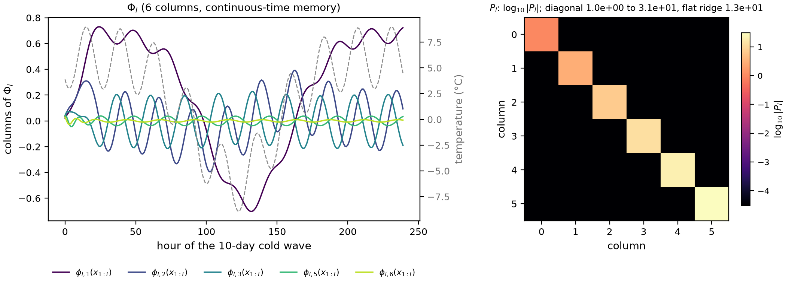

# The HiPPO State Space Model Effect (Continuous-Time Polynomial Memory)

**Navigation:**
  * **Theory introduction:** [See the Intro](../../THEORY.md)
  * **Related code architecture:** [See the Code Architecture](../../architecture/core/06_the_spectrum_api.md)

## Foundational Theory: Continuous-Time Memory & Polynomial Projections

In dynamical time series modeling, incorporating long-range temporal history of exogenous covariates (e.g., multi-day building thermal inertia or hydrological retention) poses severe mathematical challenges. Traditional finite autoregressive distributed lags ($x_{t-k}$) suffer from exponential parameter inflation, severe multicollinearity, and lack of temporal discretization invariance. Similarly, rolling heuristics or simple momentum features cannot capture multi-scale memory decay.

To solve continuous-time memory compression within the Primal Reproducing Kernel Hilbert Space, the framework operationalizes **High-Order Polynomial Projection Operators (HiPPO)** {cite:p}`gu2020hippo` and **Structured State Space Models (S4 / S4D / S5)** {cite:p}`gu2022efficiently, gu2022parameterization, smith2023simplified`.

Given an input covariate trajectory $u(t) \in \mathbb{R}$, HiPPO maintains at every continuous time $t$ an $N$-dimensional state vector:

$$s(t) = \begin{bmatrix} s_0(t) \\ s_1(t) \\ \vdots \\ s_{N-1}(t) \end{bmatrix} \in \mathbb{R}^N$$

representing the continuous coefficients of the optimal orthogonal projection of the history $u_{\le t} = \{u(\tau)\}_{\tau \le t}$ onto shifted Legendre polynomials $\{P_n\}_{n=0}^{N-1}$ with respect to a time-varying measure $\mu_t$.

## Continuous Differential Systems

Differentiating the projection operator with respect to time yields a continuous linear time-invariant (LTI) differential system:

$$\frac{d}{dt} s(t) = A s(t) + B u(t), \qquad y_{\text{hippo}}(t) = \theta^\top s(t)$$

where the transition operator $A \in \mathbb{R}^{N \times N}$ and input projection vector $B \in \mathbb{R}^N$ are determined analytically by the choice of projection measure:

### 1. Translated Legendre Measure (HiPPO-LegT)
HiPPO-LegT maintains a sliding memory window of length $\theta_w$ with uniform weighting over $[t - \theta_w, t]$:

$$A_{n, k}^{\text{LegT}} = -\frac{1}{\theta_w} \sqrt{2n+1}\sqrt{2k+1} \begin{cases} 1 & \text{if } k \le n \\ (-1)^{n-k} & \text{if } k > n \end{cases}, \qquad B_n^{\text{LegT}} = \frac{1}{\theta_w}\sqrt{2n+1}$$

### 2. Scaled Legendre Measure (HiPPO-LegS)
HiPPO-LegS maintains memory over the entire past trajectory $[0, t]$ with uniform density, yielding a lower-triangular transition operator:

$$A_{n, k}^{\text{LegS}} = -\begin{cases} \sqrt{2n+1}\sqrt{2k+1} & \text{if } n > k \\ n + 1 & \text{if } n = k \\ 0 & \text{if } n < k \end{cases}, \qquad B_n^{\text{LegS}} = \sqrt{2n+1}$$

### 3. Laguerre Measure (HiPPO-LagT)
Exponentially decayed memory measure with smooth asymptotic forgetting:

$$A_{n, k}^{\text{LagT}} = -\begin{cases} 1 & \text{if } n \ge k \\ 0 & \text{if } n < k \end{cases}, \qquad B_n^{\text{LagT}} = 1$$

## Discretization Transforms: Bilinear & Zero-Order Hold (ZOH)

Given discrete observation steps with sampling interval $\Delta = \text{dt} > 0$, the continuous differential system is mapped to discrete recurrence:

$$s_t = \bar{A} s_{t-1} + \bar{B} u_t$$

The framework supports two exact discretization transforms:

1. **Bilinear (Tustin) Transform**:
   Preserves the frequency response and ensures absolute stability by mapping the continuous left-half plane into the unit circle:

   $$\bar{A} = \left(I - \frac{\Delta}{2} A\right)^{-1} \left(I + \frac{\Delta}{2} A\right), \qquad \bar{B} = \left(I - \frac{\Delta}{2} A\right)^{-1} (\Delta B)$$

2. **Zero-Order Hold (ZOH)**:
   Assumes piecewise-constant input between sampling instants. Evaluated via Van Loan's augmented matrix exponential method:

   $$\exp\left( \Delta \begin{bmatrix} A & B \\ 0 & 0 \end{bmatrix} \right) = \begin{bmatrix} \bar{A} & \bar{B} \\ 0 & 1 \end{bmatrix}, \qquad \bar{A} = \exp(\Delta A), \quad \bar{B} = A^{-1}(\bar{A} - I)B$$

## Causal FFT Convolution & Primal Design Matrix

Unrolling the linear recurrence from initial rest $s_{-1} = 0$ yields a causal discrete convolution between the input covariate sequence $u = (u_0, \dots, u_{T-1})^\top$ and the $N$-channel SSM impulse-response kernel $\mathcal{K} \in \mathbb{R}^{T \times N}$:

$$\mathcal{K}_\ell = \bar{A}^\ell \bar{B} \in \mathbb{R}^N \quad (\ell = 0, \dots, T-1), \qquad s_t = \sum_{\ell=0}^t \mathcal{K}_{t-\ell} u_\ell$$

By the **FFT Convolution Theorem**, zero-padding the sequences to length $2T$ allows evaluating the entire Primal design matrix $\Phi_{\text{HiPPO}} = [s_0, s_1, \dots, s_{T-1}]^\top \in \mathbb{R}^{T \times N}$ in $\mathcal{O}(N T \log T)$ time:

$$\Phi_{\text{HiPPO}}(u) = \mathcal{F}^{-1} \Big( \mathcal{F}(\mathcal{K}) \odot \mathcal{F}(u) \Big)_{0:T}$$

bypassing all sequential recurrence bottlenecks on GPU and CPU.

## Legendre Dirichlet Degree Penalty Matrix ($P_{\text{HiPPO}}$)

Because coordinate $n \in \{0, \dots, N-1\}$ corresponds to the shifted Legendre polynomial $P_n$ of degree $n$, the $L^2$ Dirichlet derivative energy scales as $n(n+1)$. To prevent high-degree polynomial overfitting on high-frequency stochastic noise, the framework introduces the positive-definite diagonal penalty:

$$P_{\text{HiPPO}} = \lambda \cdot \operatorname{diag}\Big( 1 + \big(n(n+1)\big)^p \Big)_{n=0}^{N-1} \in \mathbb{R}^{N \times N}$$

where $p \ge 0$ (default $p = 1.0$) penalizes high-degree oscillations while leaving low-degree cumulative thermal inertia ($n=0, 1$) lightly regularized.

The readout parameters $\theta \in \mathbb{R}^N$ are computed in closed form in the unified P-WLS system:

$$\left( \Phi_{\text{HiPPO}}^\top W \Phi_{\text{HiPPO}} + T P_{\text{HiPPO}} \right) \theta = \Phi_{\text{HiPPO}}^\top W y$$

## Initial state and continuation

The kernel convolution above starts from rest, $s_{-1} = 0$. To continue a series, the unforced response of the state at the end of the previous pass is added: $s_t \mathrel{+}= \bar A^{\,t+1} s_{-1}$ with $s_{-1}$ the last state of the same group (`continue_state=True`). The recurrence, the kernel and the unforced response are evaluated in float64, whatever the dtype of the input, because the transition matrix is applied up to $T$ times.

## Causality and groups

$s_t$ depends on $u_0, \dots, u_t$ of its own group only. The state is `{"c": (B, N)}`, one vector per group; a state of another number of groups raises a `ValueError`.

## Chunk equivalence

The features of a series computed in one pass over it equal the features computed in two chunks when the second chunk starts from the terminal state of the first. Three mechanisms carry that state, and this effect uses a **recurrence state** (the value of the filters or of the running sums at the last step) and **frozen training statistics** (constants estimated once on the training period, which a later chunk does not update). Because the state is exactly what a later row reads from the past, a forecast can continue a fitted series one chunk at a time without refitting or recomputing the past.

## What is new here

The HiPPO operators, their discretizations and the state space models of the cited papers are unchanged. What this effect adds:

- the **memory state as a regression basis**: the $N$ coordinates of the polynomial projection of the past of a covariate are the columns of an additive-model term, with the Legendre degree penalty above, solved in closed form;
- the **group-wise carried state** that lets a forecast continue the memory of the training period;
- the **float64 evaluation** of the impulse response and of the unforced response, which keeps the features of long series accurate when the input is single precision.

## References

- Gu, Albert et al. (2020). *HiPPO: Recurrent Memory with Optimal Polynomial Projections*. Advances in Neural Information Processing Systems (NeurIPS). `gu2020hippo`
- Gu, Albert et al. (2022). *On the parameterization and initialization of diagonal state space models*. Advances in Neural Information Processing Systems (NeurIPS). `gu2022parameterization`
- Smith, Jimmy T H, Warrington, Andrew, Linderman, Scott W (2023). *Simplified state space layers for sequence modeling*. International Conference on Learning Representations (ICLR). `smith2023simplified`
- Wood, Simon N (2017). *Generalized additive models: an introduction with R*. chapman and hall/CRC. `wood2017generalized`
