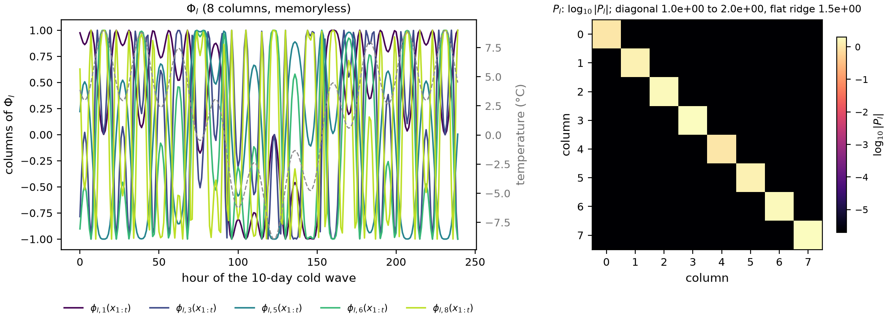

# Hurst Fractional Gaussian Noise Basis

**Navigation:**
  * **Theory introduction:** [See the Intro](../../THEORY.md)
  * **Related code architecture:** [See the Code Architecture](../../architecture/spectrum/HURST.md)

## Hurst Fractional Brownian Motion Penalty

For a long-memory process with Hurst exponent $H \in (0, 1)$ ({cite:p}`mandelbrot1968fractional`), fractional Gaussian noise has power spectral density $S_H(\omega) \propto |\omega|^{1 - 2H}$. The Hurst precision penalty matrix penalizes Fourier harmonics by the inverse power spectrum:

$$P_{\text{hurst}} = \lambda_p\, I_2 \otimes \operatorname{diag}\big( j^{2H - 1} \big)_{j=1}^m$$

where $j$ is the harmonic number (the $m$ sine columns come first, then the $m$ cosine columns); using $j$ in place of $|\omega_j|$ changes the weights by the constant factor $(2\pi/P)^{2H-1}$, which is absorbed in $\lambda_p$.

- **$H = 0.5$**: Ordinary Brownian motion increments (white noise); penalty is flat isotropic Ridge ($P \propto I$).
- **$H > 0.5$**: Persistent long-memory dynamics; penalizes high frequencies (the exponent $2H - 1$ is positive, so the weights $j^{2H - 1}$ grow with $j$), forcing smooth persistent autocorrelation.
- **$H < 0.5$**: Anti-persistent, rough mean-reverting dynamics; relaxes high-frequency penalties, accommodating jagged sub-diffusive paths.

## The basis

The columns are the harmonics of the value itself, $\sin(2\pi j\,x/P)$ and $\cos(2\pi j\,x/P)$ for $j = 1, \dots, k/2$, with a period $P$ equal to the span of the training values (or the given `period`). The effect is a pointwise function of the value: it has **no memory and no state**, and the groups do not interact. The span is frozen when the effect is initialized.

## What this effect is not

The effect is a **fixed fractional-smoothness prior**, not an estimator of $H$. The exponent is given and held in $[0.05, 0.95]$, and it acts on the *pointwise harmonics of the covariate* (functions of the value $x$, not of the time index). It does not estimate a Hurst exponent from the data: it is neither detrended fluctuation analysis nor rescaled-range analysis, and the fitted coefficients say nothing about the long memory of a series. Reading $H$ as a property of the load or of the covariate would be an error; it is one more smoothness knob of a penalized term.

## What is new here

The fractional Gaussian noise spectrum is the one of the cited paper {cite:p}`mandelbrot1968fractional`. What this effect adds:

- the **long-memory spectral prior used as a smoothness penalty on a harmonic basis of a covariate**: the exponent $H$ chooses how fast the penalty grows with the harmonic, interpolating between a ridge ($H = \tfrac12$) and a smoothness-promoting penalty ($H$ near 1), and is estimated nowhere: it is a modelling choice;
- the penalty inside a **closed-form penalized additive term** with a smoothing parameter chosen by GCV or REML.

## References

- Mandelbrot, Benoit B, Van Ness, John W (1968). *Fractional Brownian motions, fractional noises and applications*. SIAM Review. `mandelbrot1968fractional`
- Wood, Simon N (2017). *Generalized additive models: an introduction with R*. chapman and hall/CRC. `wood2017generalized`
