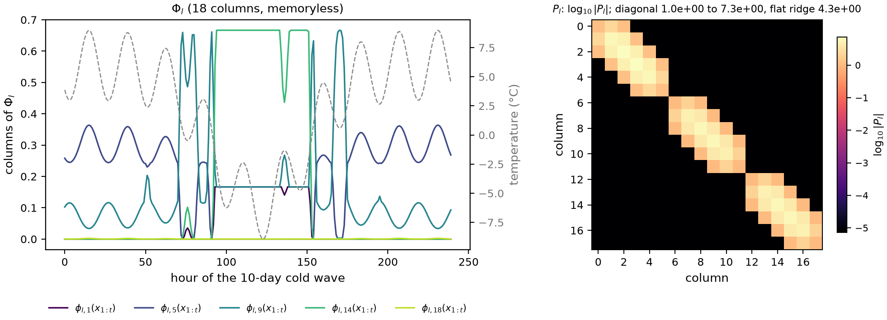

# Kolmogorov-Arnold Network Edge Splines

**Navigation:**
  * **Theory introduction:** [See the Intro](../../THEORY.md)
  * **Related code architecture:** [See the Code Architecture](../../architecture/spectrum/KAN.md)

## Kolmogorov–Arnold Network Edge Spline Basis

### Theoretical foundation
By the Kolmogorov–Arnold Representation Theorem ({cite:p}`kolmogorov1957representation`), any multivariate continuous function $f: [0, 1]^d \to \mathbb{R}$ can be expressed as:

$$f(x_1, \dots, x_d) = \sum_{q=1}^{Q} \Phi_q\!\left( \sum_{p=1}^{d} \psi_{q,p}(x_p) \right)$$

Following Liu et al. ({cite:p}`liu2024kan`), inner edge functions $\psi_{q,p}$ combine residual SiLU activation with univariate B-spline expansions:

$$\psi_{q,p}(x_p) = w_{q,p}^{(b)}\, \operatorname{silu}(x_p) + \sum_{m=1}^{k_{\text{in}}} c_{q,p,m}\, B_m(x_p)$$

### Primal representation and penalty matrix
Given $Q$ aggregation nodes $z_{t,q} = \tanh\!\big(0.28\,(u_{t,q} - \hat\mu_q)/\hat\sigma_q\big)$ with $u_{t,q} = \sum_{p=1}^d \psi_{q,p}(x_{t,p})$ (the centring and scaling are described below), outer B-splines evaluate:

$$\Phi_q(z_{t,q}) = \sum_{r=1}^{k_{\text{out}}} \theta_{q,r} B_r(z_{t,q})$$

The total Primal design matrix $\Phi_{\text{kan}} \in \mathbb{R}^{T \times (Q \cdot k_{\text{out}})}$ is regularized by a block-diagonal second-difference Sobolev roughness penalty:

$$P_{\text{kan}} = \operatorname{blkdiag}_{q=1}^Q\Big( \big(1 + \alpha_{\text{edge}}\mathcal{E}_q\big) D_2^\top D_2 + \varepsilon I \Big)\, \lambda_p$$

(the edge-roughness weight $\mathcal{E}_q$ and the small ridge $\varepsilon$ are described below).

reducing representation complexity from $\mathcal{O}(k^d)$ to $\mathcal{O}(Q d k)$ while representing exact product interactions $x_1 x_2 = \frac{1}{4}(x_1+x_2)^2 - \frac{1}{4}(x_1-x_2)^2$.

---

## Scale stabilization

The inner nodes $u_{t,q} = \sum_p \psi_{q,p}(x_{t,p})$ are centered and scaled with their training mean and standard deviation before the saturating map, $z_{t,q} = \tanh\!\big(0.28\,(u_{t,q} - \hat\mu_q)/\hat\sigma_q\big)$, so that the outer splines see values spread over $[-1, 1]$ whatever the scale of the inputs. The inner parameters $(w, c)$ are drawn once from a seeded generator in float64 and are not trained: the model stays linear in the outer coefficients $\theta$ and is solved in closed form. The edge roughness $\mathcal{E}_q$ of a node (second differences of its inner spline coefficients) multiplies the outer penalty of that node by $1 + \alpha_{\text{edge}}\mathcal{E}_q$.

## Causality and state

The effect reads one row at a time: it has no memory and no state, and a group never influences another. The standardization, the inner knots, the inner parameters and the node statistics are computed when the effect is initialized, on all the training rows, and frozen.

## Ridge on the null space

Each node block of the penalty carries, besides the weighted second differences, a small ridge $\varepsilon I$ with $\varepsilon = 10^{-6}$: $P_{\text{kan}} = \operatorname{blkdiag}_q\big((1 + \alpha_{\text{edge}}\mathcal{E}_q) D^\top D + \varepsilon I\big)\lambda_p$. The second-difference operator $D$ has the straight lines in its null space, so without the ridge the penalty is only positive semi-definite; with it the penalty is positive definite, and the log-determinant of the penalty that the restricted marginal likelihood uses is defined.

## What is new here

The representation theorem and the edge-spline network are the ones of the cited papers {cite:p}`kolmogorov1957representation, liu2024kan`. What this effect adds:

- **fixed random inner edges with an outer layer solved in closed form**: the Kolmogorov–Arnold structure is used as a dimension-reducing feature map ($Q\,k_{\text{out}}$ columns instead of $k^d$), not as a network trained by gradient descent;
- the **edge-roughness-weighted penalty** that makes the node whose inner edges are rough more expensive to use;
- the **scale-stable node normalization** before the saturating map, which keeps the outer splines in range for covariates of any unit.

## References

- Kolmogorov, Andrei Nikolaevich (1957). *On the Representation of Continuous Functions of Many Variables by Superposition of Continuous Functions of One Variable and Addition*. Doklady Akademii Nauk SSSR. `kolmogorov1957representation`
- Liu, Ziming et al. (2024). *KAN: Kolmogorov-Arnold Networks*. arXiv preprint arXiv:2404.19756. `liu2024kan`
- De Boor, Carl (1978). *A practical guide to splines*. springer New York. `de1978practical`
- Eilers, Paul HC, Marx, Brian D (1996). *Flexible smoothing with B-splines and penalties*. Statistical science. `eilers1996flexible`
