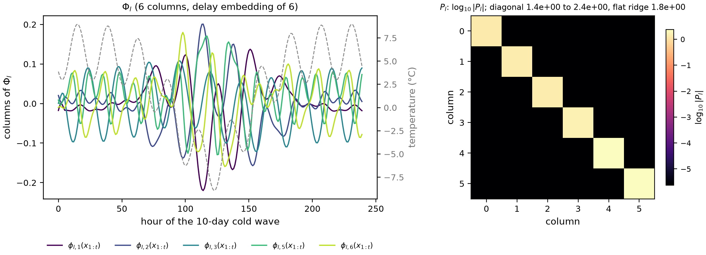

# KOOPMAN_DMD: Global Linearization of Non-linear Dynamical Systems via Kernel / Extended Dynamic Mode Decomposition (EDMD / kDMD)

## 1. The Koopman Operator and Spectral Decomposition
Let $x_{t+1} = F(x_t)$ be a discrete-time autonomous dynamical system evolving on a state manifold $\mathcal{M} \subseteq \mathbb{R}^d$. Standard linear models and local Taylor expansions fail far from equilibrium points.

By Bernard Koopman's operator theory ({cite:p}`koopman1931hamiltonian`, {cite:p}`mezic2005spectral`), any finite-dimensional non-linear dynamical system $x_{t+1} = F(x_t)$ induces an exact infinite-dimensional linear composition operator $\mathcal{K}$ acting on the Hilbert space of observable functions $g: \mathcal{M} \to \mathbb{C}$:

$$(\mathcal{K} g)(x_t) = (g \circ F)(x_t) = g(x_{t+1})$$

A scalar observable $\varphi_k: \mathcal{M} \to \mathbb{C}$ is a **Koopman eigenfunction** with associated eigenvalue $\mu_k \in \mathbb{C}$ if:

$$\varphi_k(x_{t+1}) = (\mathcal{K} \varphi_k)(x_t) = \mu_k\, \varphi_k(x_t) \implies \varphi_k(x_t) = \mu_k^t\, \varphi_k(x_0)$$

Any physical time series observable $y_t = g(x_t)$ lying in the span of the eigenfunctions admits the exact modal decomposition:

$$g(x_t) = \sum_{k=1}^K v_k\, \varphi_k(x_t) = \sum_{k=1}^K v_k\, \mu_k^t\, \varphi_k(x_0)$$

where $v_k$ are the Koopman modes solved in the TAM Primal linear framework as $\theta_{\text{koopman}}$ via P-WLS ({cite:p}`kutz2016dynamic`).

---

## 2. Extended and Kernel Dynamic Mode Decomposition (EDMD / kDMD)
To compute empirical Koopman eigenfunctions from finite observational data, we introduce a dictionary of lifting observables $\psi(x) = [\psi_1(x), \dots, \psi_M(x)]^\top \in \mathbb{R}^M$ ({cite:p}`williams2015data`, {cite:p}`williams2015kernel`).

### 2.1 Causal Time-Delay Hankel Embedding
For a scalar or low-dimensional time series $x_t \in \mathbb{R}^d$, Takens' delay embedding theorem reconstructs the full attractor via causal Hankel delay embedding of dimension $d_H$:

$$x_t^{(H)} = \begin{bmatrix} x_t \\ x_{t-1} \\ \vdots \\ x_{t - d_H + 1} \end{bmatrix} \in \mathbb{R}^{d \cdot d_H}$$

with strict causal boundary handling and persistent state continuation across training and evaluation splits.

### 2.2 Observable Lifting Dictionary
The lifted state vector $\psi(x_t^{(H)})$ comprises:
1. Linear terms: $x_t^{(H)} \in \mathbb{R}^{d \cdot d_H}$
2. Quadratic monomials: $x_{t, i}^{(H)} x_{t, j}^{(H)}$ for $i \le j$
3. Random Fourier Features: $\sin(\Omega x_t^{(H)})$ for non-polynomial non-linearities.

### 2.3 Galerkin Projection via SVD
Form snapshot matrices over $T-1$ transitions:

$$\Psi_X = \begin{bmatrix} \psi(x_0)^\top \\ \vdots \\ \psi(x_{T-2})^\top \end{bmatrix} \in \mathbb{R}^{(T-1) \times M}, \qquad \Psi_Y = \begin{bmatrix} \psi(x_1)^\top \\ \vdots \\ \psi(x_{T-1})^\top \end{bmatrix} \in \mathbb{R}^{(T-1) \times M}$$

The finite-dimensional Galerkin projection minimizing one-step transition residual $\|\Psi_Y - \Psi_X K\|_F^2$ is solved via truncated SVD $\Psi_X \approx U_r \Sigma_r V_r^\top$:

$$\tilde{K} = \Sigma_r^{-1} U_r^\top \Psi_Y V_r \in \mathbb{R}^{r \times r}$$

Eigen-decomposition of $\tilde{K}$:

$$\tilde{K} \xi_j = \mu_j \xi_j$$

yields Koopman observable eigenvectors in the lifted space:

$$w_j = V_r \Sigma_r^{-1} \xi_j \in \mathbb{C}^M$$

---

## 3. Real-Valued Primal Basis and Residual-Consistent Regularization

### 3.1 Real-Valued Feature Map ($\Phi_{\text{koopman}}$)
For real dynamical systems, complex eigenvalues occur in conjugate pairs with conjugate eigenvectors. For real eigenvalues ($\operatorname{Im}(\mu_j) = 0$), we retain the real projection $\operatorname{Re}(w_j)$. For complex pairs, we retain both real and imaginary components $[\operatorname{Re}(w_j), \operatorname{Im}(w_j)]$.

### 3.2 Residual Dynamic Mode Decomposition (ResDMD) Penalty
To eliminate spurious modes and numerical artifacts arising from finite dictionary truncation ({cite:p}`colbrook2024rigorous`), each mode is evaluated by its Koopman operator residual norm:

$$\text{res}_j^2 = \frac{\|\Psi_Y w_j - \mu_j \Psi_X w_j\|_2^2}{\|\Psi_X w_j\|_2^2 + \varepsilon}$$

Modes are sorted by ascending residual $\text{res}_j^2$, keeping the top-$K$ best invariant subspaces. The Primal penalty matrix $P_{\text{koopman}}$ penalizes modes proportional to their spectral residual and distance from the unit circle:

$$P_{\text{koopman}} = \operatorname{diag}\Big( 1 + \alpha_{\text{res}}\, \text{res}_j^2 + \alpha_{\text{unit}} \big(|\mu_j|^2 - 1\big)^2 \Big)$$

---

## Exactly $k$ columns

The effect always has $k$ columns. The empirical modes are ranked by their transition residual; a complex-conjugate pair is two neighbouring real columns (its real and imaginary parts) and is kept whole, so when a single column is left the pair is skipped and the next real mode is taken. If the data do not hold $k$ modes (a constant or very short series), the missing columns are orthonormal directions of the lifted dictionary with a very large penalty, which the solver leaves at zero. A $k$ larger than the size of the dictionary is an error.

## Causality, groups and state continuation

The delay embedding reads the current and the last $d_H - 1$ rows of the same group; the transition pairs $(\psi(x_t), \psi(x_{t+1}))$ of the EDMD are formed inside each group, never across two groups. The state is the last $d_H - 1$ rows of every group, `{"hist": (B, d_H - 1, d)}`; the lifting statistics, the dictionary and the modes are computed once on the training rows and frozen. With `delay_embed=1` the effect is pointwise and has no state. The random projection is drawn in float64 on the CPU and cast, so the same dictionary results on every device.

## Chunk equivalence

The features of a series computed in one pass over it equal the features computed in two chunks when the second chunk starts from the terminal state of the first. Three mechanisms carry that state, and this effect uses a **window history** (the last rows of every group, which complete the windows of the next chunk) and **frozen training statistics** (constants estimated once on the training period, which a later chunk does not update). Because the state is exactly what a later row reads from the past, a forecast can continue a fitted series one chunk at a time without refitting or recomputing the past.

## What is new here

EDMD, its kernel form and the Koopman modal decomposition are those of the cited papers. What this effect adds:

- the **real-valued Koopman modes as regressors of a penalized additive model**, with a penalty that grows with the residual of the mode and with the distance of its eigenvalue from the unit circle, so that unreliable modes are shrunk toward zero;
- a **fixed column budget with conjugate pairs kept together**, which keeps the design size independent of the data;
- **group-wise transitions and a per-group delay state**, which make the effect usable on panels of series.

## References

- Koopman, Bernard O (1931). *Hamiltonian systems and transformation in Hilbert space*. Proceedings of the National Academy of Sciences. `koopman1931hamiltonian`
- Mezic, Igor (2005). *Spectral properties of dynamical systems, model reduction and decompositions*. Nonlinear Dynamics. `mezic2005spectral`
- Williams, Matthew O, Kevrekidis, Ioannis G, Rowley, Clarence W (2015). *A data-driven approximation of the Koopman operator: Extending dynamic mode decomposition*. Journal of Nonlinear Science. `williams2015data`
- Williams, Matthew O, Rowley, Clarence W, Kevrekidis, Ioannis G (2015). *A kernel-based method for data-driven Koopman spectral analysis*. Journal of Computational Dynamics. `williams2015kernel`
- Kutz, J Nathan et al. (2016). *Dynamic Mode Decomposition: Data-Driven Modeling of Complex Systems*. SIAM. `kutz2016dynamic`
- Colbrook, Matthew J, Townsend, Alex (2024). *Rigorous data-driven computation of spectral properties of Koopman operators for dynamical systems*. Communications on Pure and Applied Mathematics. `colbrook2024rigorous`
