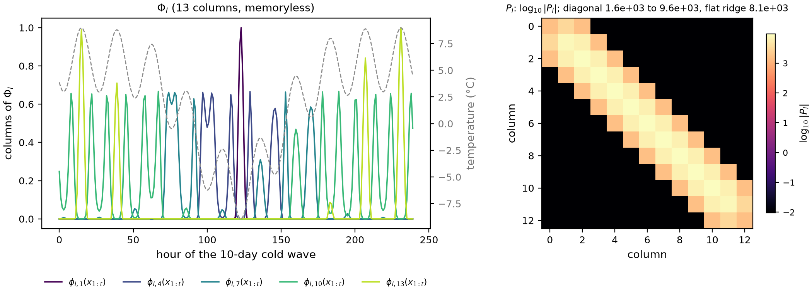

# Hodrick-Prescott Macro-Trend

**Navigation:**
  * **Theory introduction:** [See the Intro](../../THEORY.md)
  * **Related code architecture:** [See the Code Architecture](../../architecture/spectrum/MACRO_TREND.md)

## Hodrick-Prescott trend with natural boundaries

A slowly varying structural level is modelled by a cubic B-spline trend $f(t) = \sum_j \theta_j B_j(t)$ on $k$ knots of the normalised time axis, with the Hodrick-Prescott smoothing penalty on its second differences,

$$\min_\theta \; \sum_t (y_t - f(t))^2 + \lambda_{\text{HP}} \, \theta^\top D_2^\top D_2 \, \theta,$$

where $D_2$ is the second-difference operator on the coefficients. Outside the training range the basis is continued linearly (zero second derivative at the boundaries). Beyond the training range the trend therefore continues along its boundary tangent: the extrapolated level drifts linearly with the horizon, at the slope the trend has at the end of the training period.

## Range and extrapolation

The trend axis is mapped to $[-1, 1]$ with the range of the training rows, frozen when the effect is initialized (a second initialization replaces it). Outside that range the B-spline basis is continued by its tangent at the boundary, so $f$ is linear beyond the training period and its second differences vanish there. The extrapolated level drifts linearly with the distance from the end of the training range, and a strong slope at the boundary is carried over the whole horizon. The effect reads one value at a time: it has no state and groups never interact.

## What is new here

The Hodrick–Prescott filter is the one of the cited paper {cite:p}`hodrick1997postwar`. What this effect adds:

- the **penalized-spline form of the filter**, solved in the same penalized weighted least-squares system as the other terms, so the trend is estimated jointly with the weather and calendar effects instead of being removed in a first pass;
- the **linear continuation along the boundary tangent** beyond the training range, which keeps the trend defined for any horizon (the extrapolated level drifts linearly with the horizon).

## References

- Hodrick, Robert J, Prescott, Edward C (1997). *Postwar U.S. business cycles: an empirical investigation*. Journal of Money, Credit and Banking. `hodrick1997postwar`
- Eilers, Paul HC, Marx, Brian D (1996). *Flexible smoothing with B-splines and penalties*. Statistical science. `eilers1996flexible`
- Wood, Simon N (2017). *Generalized additive models: an introduction with R*. chapman and hall/CRC. `wood2017generalized`
