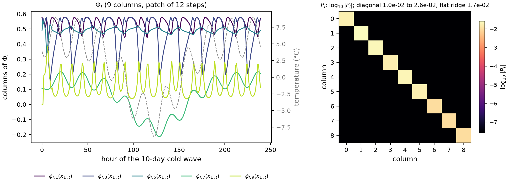

# Causal Patch Basis

**Navigation:**
  * **Theory introduction:** [See the Intro](../../THEORY.md)
  * **Related code architecture:** [See the Code Architecture](../../architecture/spectrum/PATCH_BASIS.md)

## Patch tokens with causal instance statistics

For each step $t$ the patch is the last $P$ values of the primary series, $p_t = (x_{t-P+1}, \dots, x_t)$. Its own mean and standard deviation $(\hat\mu_t, \hat\sigma_t)$, computed on the patch only, remove the local level and scale (reversible instance normalization {cite:p}`kim2022reversible`):

$$\tilde p_t = \frac{p_t - \hat\mu_t}{\sqrt{\hat\sigma_t^2 + 10^{-6}}}.$$

The normalized patch is projected on $M$ fixed orthogonal directions with a random phase, a random-feature map of a Gaussian kernel on patches {cite:p}`rahimi2007random`, in the spirit of patch tokens of long-horizon forecasters {cite:p}`nie2023time`:

$$\phi_{t,m} = \sqrt{2/M}\,\cos\big(w_m^\top \tilde p_t + b_m\big), \qquad m = 1, \dots, M,$$

where the rows $w_m$ are orthonormalized and scaled by $1.5/\sqrt{P}$ and $b_m \sim \mathcal{U}(0, 2\pi)$ (a seeded draw). Two more columns give the level and the scale that the normalization removed: $\tanh(\hat\mu_t/4)$ and $\tanh(\tfrac12\log\hat\sigma_t)$.

## Lévy-area tokens

With $D \ge 2$ channels, each pair $(a, b)$ contributes the antisymmetric Lévy area of the standardized patch paths $u^{(a)}, u^{(b)}$,

$$A_t^{(a,b)} = \tfrac12\,\overline{\big(\bar u^{(a)}\,\Delta u^{(b)} - \bar u^{(b)}\,\Delta u^{(a)}\big)}, \qquad \phi = \tanh A_t^{(a,b)},$$

the signed area enclosed by the pair of paths {cite:p}`lyons1998differential`, a measure of which channel leads. With one channel, the area between the path and its own one-step lag (rising versus falling loop) plays that role. The columns are $M + 2 + n_{\text{levy}}$ in all.

## Penalty

The ridge on a token is weighted by the roughness of its filter along the patch axis, $1 + r_m / \bar r$ with $r_m = \|D_2 w_m\|^2$ and $\bar r$ the mean over tokens, so an oscillating filter costs more than a smooth one while the overall scale stays that of a ridge; the level, scale and Lévy columns keep the plain ridge weight 1. With $P < 3$ every weight is 1.

## Causality and state continuation

A patch ends at the current step: the features of step $t$ never use a later value, and the patches of different groups never overlap. The state is the last $P - 1$ rows of each group, `{"hist": (B, P - 1, D)}`; without one the first row is replicated.

## Chunk equivalence

The features of a series computed in one pass over it equal the features computed in two chunks when the second chunk starts from the terminal state of the first. Three mechanisms carry that state, and this effect uses a **window history** (the last rows of every group, which complete the windows of the next chunk) and **frozen training statistics** (constants estimated once on the training period, which a later chunk does not update). Because the state is exactly what a later row reads from the past, a forecast can continue a fitted series one chunk at a time without refitting or recomputing the past.

## What is new here

The ingredients are those of the cited papers. What this effect adds:

- **causal patches with instance statistics computed on the patch itself**, so that no statistic of the future or of the whole series enters a feature;
- the **fixed random-phase orthogonal tokens as a regression basis**, solved by penalized weighted least squares with no trained weight;
- the **filter-roughness weighted penalty** of the tokens;
- the **Lévy-area hysteresis tokens** as regressors of an additive load model.

## References

- Kim, Taesung et al. (2022). *Reversible Instance Normalization for Accurate Time-Series Forecasting against Distribution Shift*. International Conference on Learning Representations (ICLR). `kim2022reversible`
- Rahimi, Ali, Recht, Benjamin (2007). *Random Features for Large-Scale Kernel Machines*. Advances in Neural Information Processing Systems. `rahimi2007random`
- Nie, Yuqi et al. (2023). *A Time Series is Worth 64 Words: Long-term Forecasting with Transformers*. International Conference on Learning Representations (ICLR). `nie2023time`
- Lyons, Terry J (1998). *Differential equations driven by rough signals*. Revista Matematica Iberoamericana. `lyons1998differential`
