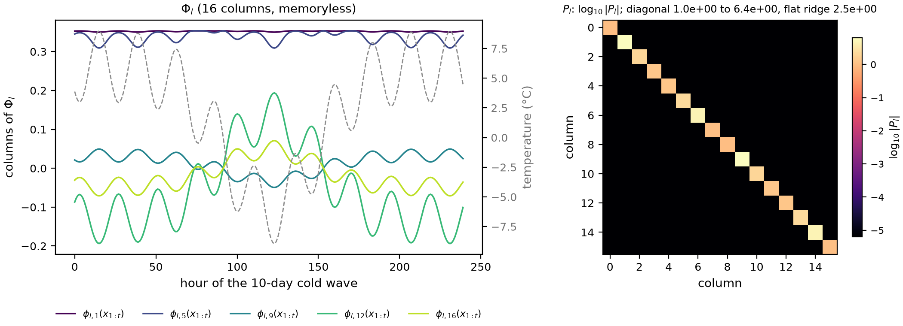

# The Prior Spectral Effect (Bochner QMC-RFF Basis)

**Navigation:**
  * **Theory introduction:** [See the Intro](../../THEORY.md)
  * **Related code architecture:** [See the Code Architecture](../../architecture/core/06_the_spectrum_api.md)

## Foundational Theory: Bochner's Theorem and Spectral Measure Representation

In traditional generalized additive models and Weak Kernel Learning, spectral effects are typically restricted to fixed harmonic Fourier series {cite:p}`harvey1989forecasting, doumeche2025forecasting` or stationary radial basis functions {cite:p}`scholkopf2002learning`. While expressive, these deterministic bases require extensive grid search or heuristic parameter tuning that degrades in short-history or cold-start regimes ($T < 100$).

To incorporate rich continuous spectral priors directly into the primal solver, the framework operationalizes **Bochner's Theorem** {cite:p}`bochner1933monotone`. According to Bochner's theorem, any continuous, shift-invariant positive-definite kernel $k(\tau) = k(x - x')$ on $\mathbb{R}^d$ is the Fourier transform of a non-negative finite Borel measure $\mu(d\omega) = S(\omega)\,d\omega$ on the frequency domain $\mathbb{R}^d$:

$$k(x - x') = \int_{\mathbb{R}^d} e^{i \omega^\top (x - x')} \, S(\omega)\, d\omega = \mathbb{E}_{\omega \sim p(\omega)} \left[ \zeta_0 \cos\big(\omega^\top (x - x')\big) \right]$$

where $\zeta_0 = \int_{\mathbb{R}^d} S(\omega)\,d\omega$ is the total spectral power and $p(\omega) = S(\omega)/\zeta_0$ represents the normalized probability density of active frequencies.

## Analytical & Foundation Spectral Densities

The spectral density $p(\omega)$ can be defined through two complementary mechanisms:

### 1. Analytical Matérn and Lorentzian Spectral Priors
For a Matérn kernel with smoothness parameter $\nu > 0$ and length-scale $\ell > 0$, the exact spectral density is a generalized multivariate Student-$t$ distribution {cite:p}`williams2006gaussian`:

$$p_{\text{Matérn}}(\omega; \nu, \ell) = \frac{\Gamma(\nu + d/2)}{\pi^{d/2}\Gamma(\nu)} \frac{\ell^d}{\left(1 + \ell^2 \|\omega\|_2^2\right)^{\nu + d/2}}$$

For the boundary case $\nu = 1/2$ (Ornstein–Uhlenbeck / exponential covariance), this reduces to the classical Cauchy-Lorentzian spectral distribution:

$$p_{\text{Lorentzian}}(\omega; \ell) = \frac{1}{\pi} \frac{\ell}{1 + \ell^2 \omega^2}$$

### 2. Empirical and Foundation Time Series Priors
A series observed on a training window carries its own spectral prior. When `prior='empirical'` is requested, the framework computes the discrete periodogram $\hat{S}(\omega) = |\mathcal{F}(x - \bar{x})|^2$ on the training context window without future look-ahead, normalizes it to an empirical probability mass function $\hat{p}(\omega_m) = \frac{\hat{S}(\omega_m)}{\sum_j \hat{S}(\omega_j)}$, and inverts its cumulative distribution function $F^{-1}(u)$ to extract data-driven frequency modes.

## Quasi-Monte Carlo Primal Feature Map ($\Phi_{\text{prior}}$)

Following the foundational Random Fourier Features (RFF) paradigm {cite:p}`rahimi2007random`, the continuous expectation is discretized into a finite set of $M$ frequencies $\Omega = \{\omega_1, \dots, \omega_M\}$. Rather than drawing pseudo-random frequencies with high variance, the framework utilizes **Quasi-Monte Carlo (QMC)** low-discrepancy sequences (Halton or Sobol) $\{u_m\}_{m=1}^M \subset (0, 1)^d$ {cite:p}`yang2014quasi`.

The frequencies are obtained via deterministic inverse-CDF transformation $\omega_m = F_p^{-1}(u_m)$. By the trigonometric cosine addition identity:

$$\cos\big(\omega_m^\top (x - x')\big) = \cos(\omega_m^\top x)\cos(\omega_m^\top x') + \sin(\omega_m^\top x)\sin(\omega_m^\top x')$$

the explicit Primal feature map $\phi_{\text{prior}}(x) \in \mathbb{R}^{2M}$ is given by:

$$\phi_{\text{prior}}(x) = \frac{1}{\sqrt{M}} \begin{bmatrix} \cos(\omega_1^\top x) \\ \vdots \\ \cos(\omega_M^\top x) \\ \sin(\omega_1^\top x) \\ \vdots \\ \sin(\omega_M^\top x) \end{bmatrix}, \quad \Phi_{\text{prior}}(X) \in \mathbb{R}^{T \times 2M}$$

By Koksma–Hlawka inequality and QMC integration bounds, the approximate kernel Gram matrix converges to the exact kernel at the accelerated rate:

$$\sup_{x, x'} \left| \phi_{\text{prior}}(x)^\top \phi_{\text{prior}}(x') - k(x, x') \right| = \mathcal{O}\left( \frac{(\log M)^d}{M} \right)$$

substantially outperforming standard Monte Carlo sampling $\mathcal{O}(M^{-1/2})$.

## Generalized Sobolev Spectral Penalty ($P_{\text{prior}}$)

To control RKHS roughness while penalizing extreme high-frequency modes, the effect imposes a strictly positive-definite diagonal Sobolev penalty matrix $P_{\text{prior}} \in \mathbb{R}^{2M \times 2M}$:

$$P_{\text{prior}} = \lambda \cdot \operatorname{diag}\Big( [\gamma(\omega_m)]_{m=1}^M \oplus [\gamma(\omega_m)]_{m=1}^M \Big), \quad \gamma(\omega_m) = \left( 1 + \|\omega_m\|_2^2 \right)^s$$

where $s \ge 0$ is the Sobolev order. Because $\gamma(\omega_m) \ge 1 > 0$ for all frequencies, $P_{\text{prior}}$ is strictly positive definite. The model coefficients $\theta \in \mathbb{R}^{2M}$ are solved in closed form within the unified P-WLS normal equations:

$$\left( \Phi_{\text{prior}}^\top W \Phi_{\text{prior}} + T P_{\text{prior}} \right) \theta = \Phi_{\text{prior}}^\top W y$$

preserving exact additive decomposition and analytical GCV / REML hyperparameter tuning.

## Causality and groups

The feature map is a pointwise function of the value: no memory, no state, and a group never influences another. With `prior='empirical'` the periodogram is computed once, when the effect is initialized, on the training values taken group after group; the sampled frequencies are then frozen. The projection weights are drawn on the CPU and moved to the device of the input, and the output keeps the dtype of the input.

## What is new here

Bochner's theorem, random Fourier features and their quasi-Monte Carlo version are the ones of the cited papers. What this effect adds:

- the **choice of the frequency measure as a prior of the additive model**: a Matérn or Lorentzian spectral density, or the periodogram of the training series, inverted by low-discrepancy points, in place of a fixed harmonic grid;
- the **Sobolev penalty $(1 + \|\omega\|^2)^s$ on the sampled frequencies**, so that the smoothness implied by the prior is the one the penalized solver enforces;
- the use of the spectral features as one **spectrum effect among others** in a closed-form penalized system, with a smoothing parameter chosen by GCV or REML.

## References

- Bochner, Salomon (1933). *Monotone Funktionen, Stieltjessche Integrale und harmonische Analyse*. Mathematische Annalen. `bochner1933monotone`
- Rahimi, Ali, Recht, Benjamin (2007). *Random Features for Large-Scale Kernel Machines*. Advances in Neural Information Processing Systems. `rahimi2007random`
- Yang, Jiyan et al. (2014). *Quasi-Monte Carlo feature maps for shift-invariant kernels*. International Conference on Machine Learning (ICML). `yang2014quasi`
- Rasmussen, Carl Edward, Williams, Christopher KI (2006). *Gaussian processes for machine learning*. MIT press Cambridge, MA. `williams2006gaussian`
