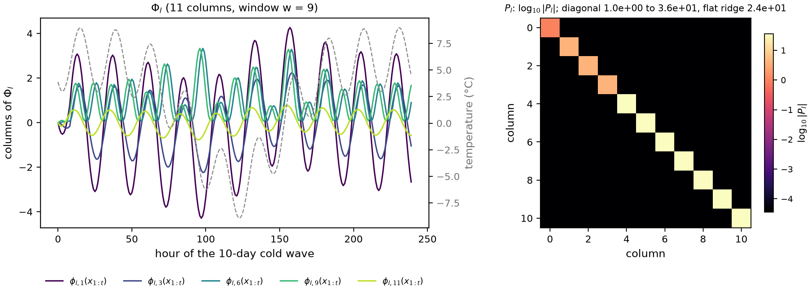

# The Path Signature and Log-Signature Effect (Rough Path Iterated Integrals)

**Navigation:**
  * **Theory introduction:** [See the Intro](../../THEORY.md)
  * **Related code architecture:** [See the Code Architecture](../../architecture/core/06_the_spectrum_api.md)

## Foundational Theory: The Path Signature

In dynamical time-series forecasting, capturing the multi-scale trajectory and memory of exogenous covariates (such as building thermal inertia driven by weather history) traditionally requires manual engineering of exponential smoothings or distributed lags. The **Path Signature** {cite:p}`chen1958integration, lyons2007differential` provides a canonical, non-parametric, linear coordinate system on the space of continuous paths of bounded variation.

Let $X: [s, t] \to \mathbb{R}^D$ be a continuous path of bounded variation. The **signature** $S(X)_{s, t}$ is the collection of all iterated integrals of $X$:

$$S(X)_{s, t} = \left( 1, S^1(X)_{s, t}, S^2(X)_{s, t}, \dots, S^N(X)_{s, t}, \dots \right)$$

where the level-$k$ iterated integral is defined by:

$$S^k(X)_{s, t} = \int_{s < u_1 < \dots < u_k < t} dX_{u_1} \otimes \dots \otimes dX_{u_k} \in (\mathbb{R}^D)^{\otimes k}$$

Truncated to level $N$, the signature provides a rich feature map in the tensor algebra $T^N(\mathbb{R}^D) = \bigoplus_{k=0}^N (\mathbb{R}^D)^{\otimes k}$, having total dimension:

$$\dim T^N(\mathbb{R}^D) = \sum_{k=0}^N D^k = \frac{D^{N+1} - 1}{D - 1}$$

### Universal Functional Approximation
By the Stone–Weierstrass theorem and Chen's non-commutative representation theorems, any continuous functional $F(X)$ of the translated trajectory can be approximated arbitrarily well by a **linear functional** of the truncated signature:

$$F(X) \approx \langle \theta,\, S^N(X) \rangle$$

This aligns directly with the Primal Generalized Additive Model framework: non-linear path dynamics are linearized into an explicit design matrix $\Phi_{\text{sig}}$ solved globally by the penalized weighted least-squares solver.

---

## Algebraic Properties & Chen's Identity

1. **Straight Line Segments:**
   For a straight segment with increment $\Delta = X_t - X_s \in \mathbb{R}^D$, the signature equals the tensor exponential:

   $$S^k(\Delta) = \frac{\Delta^{\otimes k}}{k!}$$

2. **Chen's Concatenation Identity:**
   For two concatenated paths $X * Y$, the signature of the concatenation equals the truncated tensor product of the individual signatures:

   $$S(X * Y) = S(X) \otimes S(Y), \qquad (S(X) \otimes S(Y))^{(k)} = \sum_{j=0}^k S^j(X) \otimes S^{k-j}(Y)$$

   Consequently, the signature of any piecewise linear path is evaluated in closed form as the ordered product of its segment exponentials.

3. **Time Reversal (Tensor Inversion):**
   The signature of the time-reversed path $\overleftarrow{X}$ satisfies:

   $$S(X) \otimes S(\overleftarrow{X}) = (1, 0, 0, \dots)$$

4. **Invariances & Time Augmentation:**
   The signature is intrinsically invariant to translation ($X \mapsto X + c$) and monotone reparametrizations of time ($t \mapsto \psi(t)$). Appending a normalized time coordinate $t \in [0, 1]$ (time augmentation, $D = d + 1$) restores speed and duration information.

---

## Log-Signature & Free Lie Algebra Compression

Because signature coefficients satisfy **shuffle product identities** ($S^{\mathbf{I}} S^{\mathbf{J}} = \sum_{\mathbf{K} \in \mathbf{I} \sqcup\!\sqcup \mathbf{J}} S^{\mathbf{K}}$) {cite:p}`reizenstein2020algorithm, chevyrev2016primer`, raw signature columns exhibit collinearity as $N$ grows.

By the Campbell–Baker–Hausdorff theorem, the signature of any path of bounded variation lies in the free nilpotent Lie group $G^N(\mathbb{R}^D) = \exp(\mathfrak{g}^N(\mathbb{R}^D))$. The **Log-Signature** is defined via the truncated tensor logarithm:

$$\log^{\otimes}\!\big(S^{\le N}(X)\big) = \pi_{\le N} \sum_{k=1}^N \frac{(-1)^{k-1}}{k} \big(S^{\le N}(X) - \mathbf{1}\big)^{\otimes k} \in \mathfrak{g}^N(\mathbb{R}^D)$$

where $S^{\le N}(X)$ is the signature truncated at level $N$, $\mathbf{1}$ the unit of the tensor algebra, and $\pi_{\le N}$ the projection that keeps the levels up to $N$ (the $k$-th power contains levels up to $kN$).
The first levels are $L^1 = S^1$, $L^2 = S^2 - \tfrac12 S^1 \otimes S^1$, $L^3 = S^3 - \tfrac12 (S^1 \otimes S^2 + S^2 \otimes S^1) + \tfrac13 (S^1)^{\otimes 3}$, and the features are the coordinates of $L^m$ indexed by the Lyndon words of length $m$.

### Witt's Dimension & Lyndon Word Basis
The dimension of the homogeneous Lie algebra at level $k$ is given by Witt's necklace formula:

$$\beta(D, k) = \frac{1}{k} \sum_{m \mid k} \mu(m) D^{k/m}$$

A linear basis for $\mathfrak{g}^N(\mathbb{R}^D)$ is given by the **Lyndon words** over $\{0, \dots, D-1\}$ (words strictly smaller than all their proper non-trivial suffixes). Projecting the tensor logarithm onto the Lyndon basis retains exactly $\sum_{k=1}^N \beta(D, k)$ features, eliminating all algebraic redundancies.

---

## Lévy Area & Hoff's Lead-Lag Transform

At level $k = 2$, the iterated integral $S^2(X)_{i, j}$ decomposes into a symmetric increment component and an antisymmetric **Lévy stochastic area** {cite:p}`flint2016discretely, fermanian2021embedding`:

$$S^2(X)_{i, j} = \frac{1}{2} \Delta X^i \Delta X^j + A_{i, j}(X), \qquad A_{i, j}(X) = \frac{1}{2}\left( S^2(X)_{i, j} - S^2(X)_{j, i} \right)$$

Geometrically, $A_{i, j}(X)$ is the signed chordal area enclosed by the 2D planar projection $(X_u^i, X_u^j)$. If covariate $i$ **leads** (rises before) covariate $j$, $A_{i, j}(X) > 0$.

### Hoff's Lead-Lag Transformation
For discrete sampled series $\{x_0, \dots, x_{T-1}\} \subset \mathbb{R}^d$, the **Hoff Lead-Lag path** in $\mathbb{R}^{2d}$ advances the lead component before the lag component (the coordinates are ordered lag, lead):

$$X^{\text{lead-lag}}_{2k} = (x_k, x_k), \qquad X^{\text{lead-lag}}_{2k+1} = (x_k, x_{k+1})$$

The Lévy area between lead and lag coordinates directly captures the discrete **realized quadratic covariation** $\sum_k \Delta x_k^i \Delta x_k^j$ and cross-correlation lags.

---

## Factorial Level-Dependent Ridge Penalty ($P_{\text{sig}}$)

By Lyons' inequality, the iterated integrals decay factorially with degree:

$$\|S^k(X)\| \le \frac{\|X\|_{1-\text{var}}^k}{k!}$$

To regularize higher-order terms proportionally to their natural amplitude, the penalty matrix applies a level-dependent factorial weight:

$$P_{\text{sig}} = \lambda \operatorname{diag}\Big( (k!)^2 \text{ repeated for each dimension of level } k \Big)_{k=1}^N$$

guaranteeing strict positive-definiteness ($P \succ 0$) and stable GCV/REML hyperparameter estimation.

---

## Causality and State Continuation

Each step $t$ reads the window $x_{t-\ell-w+1:t-\ell}$ of its own group (window length $w$, delay $\ell$ = `lag`): the signature of step $t$ never uses a later value, and two groups never share a window. The window starts $w - 1 + \ell$ steps before the first row of a pass, so a pass is prepended with that many steps of history: the replicated first row when there is none, or the last $w - 1 + \ell$ rows of the previous pass when `continue_state=True`. A pass of one step (or fewer steps than the lag) is therefore well defined, and predicting a test period right after the training period gives the same features as one pass over both.

The increments of every window are divided by their standard deviation over the training windows (all groups together), a statistic that is frozen when the effect is initialized.

## Chunk equivalence

The features of a series computed in one pass over it equal the features computed in two chunks when the second chunk starts from the terminal state of the first. Three mechanisms carry that state, and this effect uses a **window history** (the last rows of every group, which complete the windows of the next chunk) and **frozen training statistics** (constants estimated once on the training period, which a later chunk does not update). Because the state is exactly what a later row reads from the past, a forecast can continue a fitted series one chunk at a time without refitting or recomputing the past.

## What Is New Here

The signature, the log-signature and the lead-lag transform are the ones of the cited papers. What this effect adds:

- the **sliding causal window with a carried history**, which turns the signature of a path into a feature of a time series that can be continued from the training period to the prediction period without recomputing the past;
- the **factorial level-dependent ridge** $\lambda\,(k!)^2$ per level, chosen so that the penalty follows the decay of the iterated integrals (Lyons' inequality) and is solved together with the other spectrum effects by penalized weighted least squares, with a smoothing parameter chosen by GCV or REML;
- the use of the **Lévy area between a covariate and its lag** (lead-lag) as a regressor of an additive model of the load.

## References

- Chen, Kuo-Tsai (1958). *Integration of paths - a faithful representation of paths by non-commutative formal power series*. Transactions of the American Mathematical Society. `chen1958integration`
- Lyons, Terry J, Caruana, Michael, Levy, Thierry (2007). *Differential Equations Driven by Rough Paths: Ecole d'Ete de Probabilites de Saint-Flour XXXIV-2004*. Springer. `lyons2007differential`
- Lyons, Terry J (1998). *Differential equations driven by rough signals*. Revista Matematica Iberoamericana. `lyons1998differential`
- Chevyrev, Ilya, Kormilitzin, Andrey (2016). *A Primer on the Signature Method in Machine Learning*. arXiv preprint arXiv:1603.03788. `chevyrev2016primer`
- Reizenstein, Jeremy, Graham, Benjamin (2020). *Algorithm 1004: The iisignature library: Efficient calculation of iterated-integral signatures and log signatures*. ACM Transactions on Mathematical Software. `reizenstein2020algorithm`
- Flint, Guy, Hambly, Ben, Lyons, Terry (2016). *Discretely sampled signals and the rough Hoff process*. Stochastic Processes and their Applications. `flint2016discretely`
- Fermanian, Adeline (2021). *Embedding and learning with signatures*. Computational Statistics & Data Analysis. `fermanian2021embedding`
