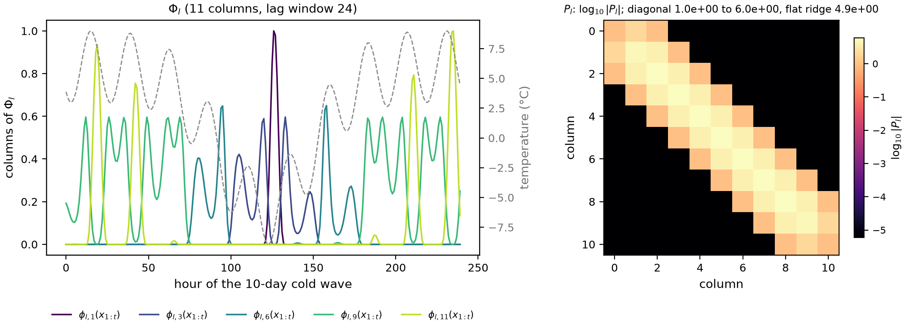

# Penalized Single-Index Distributed Lags

**Navigation:**
  * **Theory introduction:** [See the Intro](../../THEORY.md)
  * **Related code architecture:** [See the Code Architecture](../../architecture/spectrum/SINGLE_INDEX.md)

## Definition

Given a multivariate or lagged block $X_t \in \mathbb{R}^L$, the single-index smooth evaluates:

$$f_{\text{si}}(X_t) = \sum_{m=1}^{k} \theta_m B_m(X_t^\top \alpha) \quad \text{subject to} \quad \|\alpha\|_2 = 1,\; \alpha_1 \ge 0$$

regularized by an outer B-spline difference penalty $P_{\text{si}} = (D_2^\top D_2) \cdot \lambda_p$.

## The index

Two forms share the same outer spline.

- **Distributed lag** (`lag_window=L`, one column): the index of step $t$ is $u_t = \sum_{l=0}^{L-1} \alpha_l\, x_{t-l}$, a weighted sum of the last $L$ values of the series of its own group. The weights start from a smooth decay $\alpha_l \propto e^{-0.15\,l}$ (or from the user's `alpha`), normalized to unit norm with $\alpha_1 \ge 0$.
- **Multivariate block** (`others=`): the covariates are standardized with the training mean and standard deviation, and $\alpha$ is the leading principal direction of the standardized training block, regularized by a second-difference penalty on its entries {cite:p}`ichimura1993semiparametric, wood2017generalized`. No time mixing: each row is read alone.

The index is mapped to $[-1, 1]$ with the range it has on the training rows and read through a cubic B-spline with linear continuation outside the range; the spline coefficients carry the second-difference penalty above {cite:p}`eilers1996flexible`.

## Causality and state continuation

The distributed-lag form reads only $x_{t}, \dots, x_{t-L+1}$: it is strictly causal. Its state is the last $L - 1$ values of each group, `{"hist": (B, L - 1, 1)}`; without a state the first value of the pass is replicated, and with `continue_state=True` the first prediction step continues the training period. The multivariate form has no state. In both forms the standardization, the index weights $\alpha$ and the index range are fixed when the effect is initialized, from all the training groups, and never move afterwards.

## Chunk equivalence

The features of a series computed in one pass over it equal the features computed in two chunks when the second chunk starts from the terminal state of the first. Three mechanisms carry that state, and this effect uses a **window history** (the last rows of every group, which complete the windows of the next chunk) and **frozen training statistics** (constants estimated once on the training period, which a later chunk does not update). Because the state is exactly what a later row reads from the past, a forecast can continue a fitted series one chunk at a time without refitting or recomputing the past.

## What is new here

The single-index model and its penalized spline are classical. What this effect adds to the additive framework:

- **the distributed-lag index inside a penalized weighted least-squares additive model**: one spline of a lag filter, instead of one smooth term per lag;
- the **state of the lag window per group**, so that a forecast made after the training period uses the real history of each series;
- the **data-driven starting direction with a roughness regularization of $\alpha$**, which fixes the index before the spline coefficients are solved: the solver stays linear, $\alpha$ is not re-estimated inside the penalized solve.

## References

- Ichimura, Hidehiko (1993). *Semiparametric least squares (SLS) and weighted SLS estimation of single-index models*. Journal of Econometrics. `ichimura1993semiparametric`
- Wood, Simon N (2017). *Generalized additive models: an introduction with R*. chapman and hall/CRC. `wood2017generalized`
- Eilers, Paul HC, Marx, Brian D (1996). *Flexible smoothing with B-splines and penalties*. Statistical science. `eilers1996flexible`
- De Boor, Carl (1978). *A practical guide to splines*. springer New York. `de1978practical`
