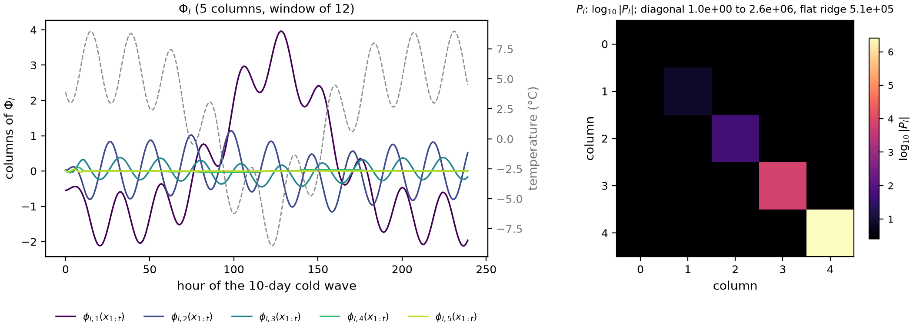

# Singular Spectrum Analysis

**Navigation:**
  * **Theory introduction:** [See the Intro](../../THEORY.md)
  * **Related code architecture:** [See the Code Architecture](../../architecture/spectrum/SSA.md)

## Singular Spectrum Analysis (SSA)

### Empirical Orthogonal Function (EOF) decomposition
Given a time series $x_{1:T}$ and embedding window $L \in [2, T/2]$ with $K = T - L + 1$, the Hankel trajectory matrix $\mathbf{H} \in \mathbb{R}^{L \times K}$ has lag-covariance:

$$\mathbf{C} = \frac{1}{K} \mathbf{H} \mathbf{H}^\top = \sum_{r=1}^{L} \sigma_r u_r u_r^\top$$

where $\{u_r\}_{r=1}^k$ are data-adaptive EOF eigenvectors with the descending eigenvalues $\sigma_1 \ge \sigma_2 \ge \dots \ge \sigma_k$ of $\mathbf{C}$ (the squared singular values of $\mathbf{H}/\sqrt{K}$); the windows are centred by the training mean $\bar{x}_{\text{train}}$ before the decomposition.

### Causal sliding window and spectral penalty
At time $t$, causal sliding windows $x_{t-L+1:t}$ are projected onto the top-$k$ EOF eigenvectors:

$$\Phi_{\text{ssa}}(x)_{t, r} = u_r^\top \big(x_{t-L+1:t} - \bar{x}_{\text{train}}\big), \qquad P_{\text{ssa}} = \operatorname{diag}\!\left( \frac{\sigma_1}{\sigma_r + 10^{-6}} \right)_{r=1}^k \cdot \lambda_p$$

Causal state continuation carries the trailing $L - 1$ samples from training to prediction frames, ensuring zero discontinuity across splits.

---

## Groups, centering and state

The series is centered with its training mean. The trajectory (Hankel) matrix is built **for each group separately** and the lag-covariance $\mathbf{C}$ is the average over the windows of all the groups: a window never spans two groups. A pass shorter than $L + 1$ steps at initialization falls back on the first $k$ coordinate directions. The state is the last $L - 1$ centered values of every group, `{"hist": (B, L - 1, 1)}`; the EOFs and the mean are frozen when the effect is initialized.

## Chunk equivalence

The features of a series computed in one pass over it equal the features computed in two chunks when the second chunk starts from the terminal state of the first. Three mechanisms carry that state, and this effect uses a **window history** (the last rows of every group, which complete the windows of the next chunk) and **frozen training statistics** (constants estimated once on the training period, which a later chunk does not update). Because the state is exactly what a later row reads from the past, a forecast can continue a fitted series one chunk at a time without refitting or recomputing the past.

## What is new here

Singular spectrum analysis and its Hankel EOFs are those of the cited references {cite:p}`broomhead1986extracting, golyandina2001analysis`. What this effect adds:

- the **causal projection of the sliding window on fixed EOFs as regression columns** of an additive model, so the data-adaptive oscillation modes enter a closed-form penalized term;
- the **spectral penalty $\sigma_1/\sigma_r$**, which shrinks the weak modes more than the dominant ones;
- the **panel version**, where the EOFs are estimated from the windows of all the groups.

## References

- Broomhead, David S, King, Gregory P (1986). *Extracting qualitative dynamics from experimental data*. Physica D: Nonlinear Phenomena. `broomhead1986extracting`
- Golyandina, Nina, Nekrutkin, Vladimir, Zhigljavsky, Anatoly A (2001). *Analysis of Time Series Structure: SSA and Related Techniques*. Chapman & Hall/CRC. `golyandina2001analysis`
- Wood, Simon N (2017). *Generalized additive models: an introduction with R*. chapman and hall/CRC. `wood2017generalized`
