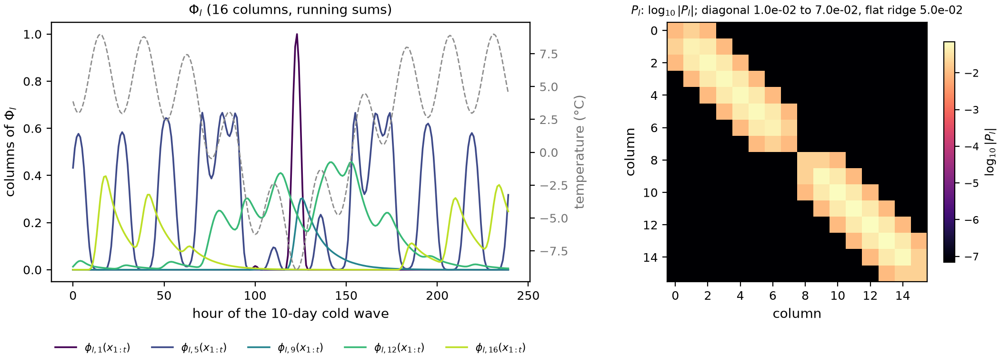

# Temporal Operators on an Evaluated Basis

**Navigation:**
  * **Theory introduction:** [See the Intro](../../THEORY.md)
  * **Related code architecture:** [See the Code Architecture](../../architecture/spectrum/TEMPORAL_OPERATOR.md)

## Operator paradigm

A time-mixing mechanism applied directly to a raw covariate creates a high-dimensional block that competes poorly with smooth functional bases. A **temporal operator** instead acts on an evaluated inner basis $\Phi_{\text{base}}(X) \in \mathbb{R}^{T \times K}$ (a spline, Fourier or linear basis of the covariate) and appends its causal mixture:

$$\Phi(X)_t = \big[\,\Phi_{\text{base}}(X)_t \;\big|\; \mathcal{T}_{\text{op}}(\Phi_{\text{base}})_t\,\big] \in \mathbb{R}^{2K}.$$

The operator is linear along time and acts column by column on the basis, so the functional geometry of the inner basis is kept and its penalty $P_{\text{base}}$ applies to both blocks:

$$P_{\text{op}} = \operatorname{blkdiag}\big(\lambda_{\text{base}} P_{\text{base}}, \;\lambda_{\text{op}}(P_{\text{base}} + I_K)\big).$$

## The three operators

Write $\Phi_t \in \mathbb{R}^{K}$ for the row of the inner basis at step $t$ and $d \in (0, 1)$ for `decay`.

1. **Exponential random-feature attention (`attn`)** {cite:p}`choromanski2021rethinking`. With positive random features $\varphi_t = \exp\big(\operatorname{clip}(W^\top \Phi_t - \|\Phi_t\|^2 / (2K))\big) \in \mathbb{R}^{m}$ ($W$ a seeded orthogonal projection), two discounted prefix sums are carried:

   $$S_t = d\,S_{t-1} + (1 - d)\,\varphi_t \otimes \Phi_t, \qquad Z_t = d\,Z_{t-1} + (1 - d)\,\varphi_t, \qquad \mathcal{T}_{\text{attn}}(\Phi)_t = \frac{\varphi_t^\top S_t}{\varphi_t^\top Z_t}.$$

   It is a causal softmax-like attention over the past rows of the basis, with exponential forgetting, computed in linear time.

2. **Multi-rate exponential memory (`hippo`)** {cite:p}`gu2020hippo`. Every column $k$ of the basis has its own forgetting rate $r_k$ ($r_k$ equally spaced in $[0.05, 0.5]$):

   $$h_{t,k} = (1 - r_k)\,h_{t-1,k} + r_k\,\Phi_{t,k}, \qquad \mathcal{T}_{\text{hippo}}(\Phi)_{t,k} = h_{t,k},$$

   started at the first row. It is a bank of first-order low-pass filters, one per basis function; it keeps the name of the memory family it comes from, but it does not use Legendre projections (see the standalone `hippo` effect for those).

3. **Windowed memory (`ssa`)** {cite:p}`golyandina2001analysis`. A weighted mean of the last $L$ rows with exponentially decaying weights $w_l \propto \exp(-l / (0.35\,L))$, $\sum_l w_l = 1$:

   $$\mathcal{T}_{\text{ssa}}(\Phi)_t = \sum_{l=0}^{L-1} w_l\,\Phi_{t-l}.$$

   It is the smoothing step of a singular-spectrum decomposition with fixed weights instead of learned singular vectors.

## Causality and state continuation

Each operator reads only the current and past rows of its own group. The state is $\{S, Z\}$ (`attn`), $h$ (`hippo`) or the last $L - 1$ rows (`ssa`); carrying it from the training period to the prediction period gives, to rounding, the same features as one pass over both. A state with another number of groups raises a `ValueError`. The first row of a pass without a state starts the filters at the first basis row (`hippo`, `ssa`) or at zero (`attn`).

## Penalty coordinates

The base block and the operator block have their own smoothing weight, both starting at $\lambda$ (`base` and `op`), chosen by GCV or REML.

## Chunk equivalence

The features of a series computed in one pass over it equal the features computed in two chunks when the second chunk starts from the terminal state of the first. Three mechanisms carry that state, and this effect uses a **recurrence state** (the value of the filters or of the running sums at the last step), a **window history** (the last rows of every group, which complete the windows of the next chunk) and **frozen training statistics** (constants estimated once on the training period, which a later chunk does not update). Because the state is exactly what a later row reads from the past, a forecast can continue a fitted series one chunk at a time without refitting or recomputing the past.

## What is new here

The random-feature attention, the memory families and the singular spectrum smoothing are the ones of the cited papers. What this effect adds:

- the **form-B construction**: the operator acts on an evaluated functional basis rather than on the raw covariate, so that the added memory columns are smooth functions of the covariate with the penalty of the basis;
- **linear-time recurrences instead of dense $T \times T$ operators**: a series of tens of thousands of steps is processed in a few seconds and a few megabytes;
- **separate smoothing parameters** for the instantaneous block and the memory block.

## References

- Choromanski, Krzysztof et al. (2021). *Rethinking Attention with Performers*. International Conference on Learning Representations (ICLR). `choromanski2021rethinking`
- Gu, Albert et al. (2020). *HiPPO: Recurrent Memory with Optimal Polynomial Projections*. Advances in Neural Information Processing Systems (NeurIPS). `gu2020hippo`
- Golyandina, Nina, Nekrutkin, Vladimir, Zhigljavsky, Anatoly A (2001). *Analysis of Time Series Structure: SSA and Related Techniques*. Chapman & Hall/CRC. `golyandina2001analysis`
- Wood, Simon N (2017). *Generalized additive models: an introduction with R*. chapman and hall/CRC. `wood2017generalized`
