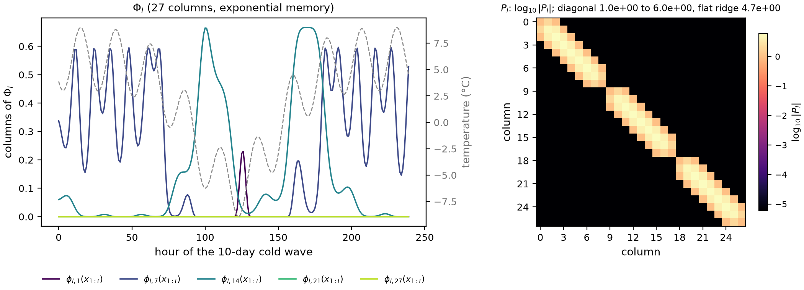

# Thermal Inertia

**Navigation:**
  * **Theory introduction:** [See the Intro](../../THEORY.md)
  * **Related code architecture:** [See the Code Architecture](../../architecture/spectrum/THERMAL_INERTIA.md)

## Multi-Timescale Physical Thermal Inertia

Structural building envelopes exhibit delayed thermal response governed by Newton's law of cooling. Given an exogenous temperature trajectory $T_t$ and a dictionary of decay constants $\{\alpha_1, \dots, \alpha_M\} \subset (0, 1]$, each causal exponentially smoothed trajectory $\tilde{T}_t(\alpha_m)$ satisfies the first-order infinite impulse response (IIR) recurrence:

$$\tilde{T}_t(\alpha_m) = \alpha_m T_t + (1 - \alpha_m)\tilde{T}_{t-1}(\alpha_m), \qquad \tilde{T}_0(\alpha_m) = T_0$$

Because the recurrence is strictly causal, its final state $\tilde{T}_T(\alpha_m)$ is carried across fit-to-predict boundaries without future look-ahead. Each smoothed trajectory is normalized to $[-1, 1]$ using frozen training bounds and evaluated through a penalized B-spline basis $B(\tilde{T}_t(\alpha_m)) \in \mathbb{R}^{K}$, with linear boundary extrapolation outside $[-1, 1]$ and a block-diagonal difference penalty:

$$P_{\text{inertia}} = \lambda \cdot I_M \otimes \left( D_p^\top D_p \right)$$

## Initial value and continuation

The recurrence of every group starts at its first normalized value, $\tilde T_{-1}(\alpha_m) = x_0$ (no history), or at the last smoothed value of the previous pass (`continue_state=True`). Solving it as a linear recurrence along time, with decay $1 - \alpha_m$ and gain $\alpha_m$, gives the smoothed series of one group in linear time, and the series of different groups never meet. With $\alpha_m = 1$ there is no memory and the trajectory is the input itself.

## Penalty coordinates

Every decay constant has its own smoothing weight $\lambda_m$ (one coordinate per $\alpha_m$, all starting at $\lambda$), so that a slow trajectory can be smoothed more than a fast one:

$$P_{\text{inertia}} = \operatorname{blkdiag}_{m}\big(\lambda_m\, D_p^\top D_p\big).$$

## Chunk equivalence

The features of a series computed in one pass over it equal the features computed in two chunks when the second chunk starts from the terminal state of the first. Three mechanisms carry that state, and this effect uses a **recurrence state** (the value of the filters or of the running sums at the last step) and **frozen training statistics** (constants estimated once on the training period, which a later chunk does not update). Because the state is exactly what a later row reads from the past, a forecast can continue a fitted series one chunk at a time without refitting or recomputing the past.

## What is new here

The multi-timescale smoothing of temperature with spline links is the practice of the cited load-forecasting work {cite:p}`goude2014local`. What this effect adds:

- **all the decay constants inside one penalized additive term**, with one smoothing parameter per time scale chosen by GCV or REML, instead of a grid of constants fixed by hand;
- the **carried smoothed state per group**, so that the thermal state at the end of the training period is the starting point of the forecast;
- the **linear-time solution of the recurrence** for any length of series (loop for short passes, FFT convolution otherwise).

## References

- Goude, Yannig, Nedellec, Raphael, Kong, Nicolas (2014). *Local short and middle term electricity load forecasting with semi-parametric additive models*. IEEE Transactions on Smart Grid. `goude2014local`
- Wood, Simon N (2017). *Generalized additive models: an introduction with R*. chapman and hall/CRC. `wood2017generalized`
- Eilers, Paul HC, Marx, Brian D (1996). *Flexible smoothing with B-splines and penalties*. Statistical science. `eilers1996flexible`
- De Boor, Carl (1978). *A practical guide to splines*. springer New York. `de1978practical`
