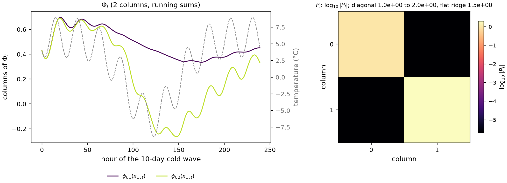

# The Transformer Attention Effect (Linearized FAVOR+ Positive Orthogonal Random Features)

**Navigation:**
  * **Theory introduction:** [See the Intro](../../THEORY.md)
  * **Related code architecture:** [See the Code Architecture](../../architecture/core/06_the_spectrum_api.md)

## Foundational Theory: Linearized Self-Attention via Kernel Factorization

Standard Transformer self-attention {cite:p}`vaswani2017attention` calculates an explicit $T \times T$ softmax attention matrix:

$$A = \operatorname{softmax}\left(\frac{Q K^\top}{\sqrt{d}}\right) = \operatorname{diag}\left(\sum_{\tau=1}^T \exp\left(\frac{q_t^\top k_\tau}{\sqrt{d}}\right)\right)^{-1} \exp\left(\frac{Q K^\top}{\sqrt{d}}\right)$$

which incurs quadratic $\mathcal{O}(T^2)$ computational complexity and memory footprint, and requires backpropagation to train non-linear projections. In the Generalized Additive Model context, non-linear backpropagation cannot be solved globally in closed form within the penalized weighted least-squares (P-WLS) solver.

By leveraging the **Performer FAVOR+ (Fast Attention Via Positive Orthogonal Random Features)** kernel factorization {cite:p}`choromanski2021rethinking, katharopoulos2020transformers`, the exponential softmax kernel $K_{\text{exp}}(q, k) = \exp(q^\top k / \sqrt{d})$ is decomposed into an inner product of strictly positive, finite-dimensional random feature maps:

$$\exp\left(\frac{q^\top k}{\sqrt{d}}\right) = \mathbb{E}\left[\phi(q)^\top \phi(k)\right]$$

Associating matrix multiplications as $\phi(Q)\big(\phi(K)^\top V\big)$ reduces complexity from $\mathcal{O}(T^2 d)$ to **linear $\mathcal{O}(T m d)$** and exposes the attention representation as an **explicit Primal design matrix** $\Phi_{\text{attn}} \in \mathbb{R}^{T \times (H \cdot d)}$ whose output projection weights $\theta$ are solved globally in closed form by the Primal Cholesky/CG solver.

---

## Positive Random Features (PRF)

Given query and key vectors $q, k \in \mathbb{R}^d$, define scaled vectors $\tilde{q} = q / d^{1/4}$ and $\tilde{k} = k / d^{1/4}$ so that $\tilde{q}^\top \tilde{k} = q^\top k / \sqrt{d}$. Using the Gaussian moment generating function identity:

$$\exp(\tilde{q}^\top \tilde{k}) = \exp\left(-\frac{\|\tilde{q}\|_2^2}{2}\right) \exp\left(-\frac{\|\tilde{k}\|_2^2}{2}\right) \mathbb{E}_{\omega \sim \mathcal{N}(0, I_d)}\left[\exp(\omega^\top (\tilde{q} + \tilde{k}))\right]$$

The **Positive Random Feature (PRF)** map $\phi: \mathbb{R}^d \to \mathbb{R}_+^m$ is defined by:

$$\phi(x) = \frac{\exp\left(-\frac{\|x\|_2^2}{2}\right)}{\sqrt{m}} \begin{bmatrix} \exp(\omega_1^\top x) \\ \vdots \\ \exp(\omega_m^\top x) \end{bmatrix} \in \mathbb{R}_+^m$$

Because $\phi(x) > 0$ strictly for all $x$, PRF eliminates negative kernel cancellations and division-by-zero instability in the denominator.

---

## Orthogonal Random Features (ORF) via Mezzadri QR

To minimize the variance of the Monte Carlo kernel estimator $\langle \phi(q), \phi(k) \rangle$ without inflating $m$, the random projection vectors $\{\omega_1, \dots, \omega_m\}$ are generated in blocks of $d$ mutually orthogonal vectors {cite:p}`yu2016orthogonal, choromanski2021rethinking`.

For each block of dimension $d \times d$:
1. Sample an unstructured standard Gaussian matrix $G \sim \mathcal{N}(0, I_{d \times d})$.
2. Compute the QR decomposition $G = Q R$.
3. Apply Mezzadri phase correction: $Q \leftarrow Q \cdot \operatorname{diag}(\operatorname{sgn}(\operatorname{diag}(R)))$ to ensure uniform Haar distribution over $\mathcal{O}(d)$.
4. Scale rows by $\sqrt{d}$ (or independent $\chi_d$ norms):

$$\Omega_{\text{ORF}} = \sqrt{d} \cdot Q_{\text{QR}}$$

By Theorem 2 of Choromanski et al. (2021), ORF yields strictly lower empirical mean squared error than independent Gaussian random features for any $d \ge 2$.

---

## Causal Linear Attention & Explicit Primal Basis ($\Phi_{\text{attn}}$)

For causal time series forecasting ($\tau \le t$), the running key-value memory matrix $M_t \in \mathbb{R}^{m \times d}$ and normalizer $z_t \in \mathbb{R}_+^m$ are defined via prefix sums across multi-scale decay factors $\gamma_h \in (0, 1]$:

$$M_t^{(h)} = \sum_{\tau=0}^t \gamma_h^{t - \tau} \phi(\tilde{x}_\tau) x_\tau^\top, \qquad z_t^{(h)} = \sum_{\tau=0}^t \gamma_h^{t - \tau} \phi(\tilde{x}_\tau)$$

The denominator normalizer and numerator context are:

$$D_t^{(h)} = \langle \phi(\tilde{x}_t),\, z_t^{(h)} \rangle + \varepsilon, \qquad N_t^{(h)} = \phi(\tilde{x}_t)^\top M_t^{(h)} \in \mathbb{R}^d$$

$$C_t^{(h)} = \frac{N_t^{(h)}}{D_t^{(h)}} \in \mathbb{R}^d$$

Concatenating across $H$ multi-scale decay heads yields the explicit Primal basis matrix:

$$\Phi_{\text{attn}} = \begin{bmatrix} C^{(1)} & C^{(2)} & \dots & C^{(H)} \end{bmatrix} \in \mathbb{R}^{T \times (H \cdot d)}$$

$M_t$ and $z_t$ are linear recurrences along time, $M_t = \gamma_h M_{t-1} + \phi(\tilde x_t) x_t^\top$ and $z_t = \gamma_h z_{t-1} + \phi(\tilde x_t)$; they are solved in $\mathcal{O}(T m d \log T)$ time and $\mathcal{O}(T m d)$ memory (a loop below 64 steps, a convolution by FFT beyond), for $\gamma_h = 1$ as for $\gamma_h < 1$.

---

## Ridge Regularization Penalty ($P_{\text{attn}}$)

To prevent overfitting across multi-scale attention heads, the Ridge regularizer applies a progressive spectral penalty:

$$P_{\text{attn}} = \lambda \operatorname{diag}\Big( (1 + h) \Big)_{h=1}^H \otimes I_d$$

guaranteeing strict positive-definiteness ($P \succ 0$) and optimal GCV/REML hyperparameter tuning.

## Heads

Every head $h$ has its own random projection $\Omega_h \in \mathbb{R}^{m \times d}$ (one seeded draw of $H\,m$ orthogonal rows, split into $H$ blocks), in the causal and in the bidirectional form, so the heads differ by their features as well as by their decay $\gamma_h$. The bidirectional form (`causal=False`) has no memory: each head contracts the whole pass of its group at once. In `bilinear` mode the columns are those of the first head.

## Causality and state continuation

In the causal form step $t$ uses $M_t, z_t$ only, that is the values up to $t$ of its own group. The state is `{"S": (B, H, m, d), "Z": (B, H, m)}`, the terminal memory and normalizer of every head; carrying it gives, to rounding, the features of one pass over both periods. A state of another number of groups raises a `ValueError`.

## Chunk equivalence

The features of a series computed in one pass over it equal the features computed in two chunks when the second chunk starts from the terminal state of the first. Three mechanisms carry that state, and this effect uses a **recurrence state** (the value of the filters or of the running sums at the last step) and **frozen training statistics** (constants estimated once on the training period, which a later chunk does not update). Because the state is exactly what a later row reads from the past, a forecast can continue a fitted series one chunk at a time without refitting or recomputing the past.

## What is new here

FAVOR+ attention and its causal prefix-sum form are the ones of the cited papers. What this effect adds:

- the **attention context as a regression basis**: the context vectors of $H$ heads, each with its own random features and decay, are the columns of an additive term whose coefficients are solved in closed form (no query, key or value matrices are trained);
- the **multi-scale decays** $\gamma_h$ as a bank of memories of different lengths in one term;
- the **group-wise carried memory** that continues a forecast from the training period.

## References

- Vaswani, Ashish et al. (2017). *Attention is all you need*. Advances in Neural Information Processing Systems (NeurIPS). `vaswani2017attention`
- Choromanski, Krzysztof et al. (2021). *Rethinking Attention with Performers*. International Conference on Learning Representations (ICLR). `choromanski2021rethinking`
- Yu, Felix Xinnan X et al. (2016). *Orthogonal random features*. Advances in Neural Information Processing Systems (NeurIPS). `yu2016orthogonal`
- Katharopoulos, Angelos et al. (2020). *Transformers are RNNs: Fast autoregressive transformers with linear attention*. International Conference on Machine Learning (ICML). `katharopoulos2020transformers`
