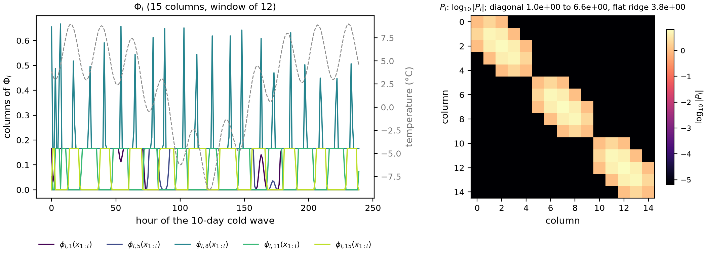

# T_JEPA: Self-Supervised Temporal Joint-Embedding Predictive Architecture for Exogenous Covariates

## 1. Problem Statement: High-Frequency Noise in Exogenous Streams
When TAM models ingest multi-channel, noisy exogenous covariate streams $X_t \in \mathbb{R}^D$ (e.g. multi-station weather observations, distributed sensor arrays, grid telemetry), classical generative reconstruction models (Autoencoders, PCA) waste representation capacity reconstructing unpredictable high-frequency observation noise $\epsilon_t$ in data space. Conversely, static random neural projections cannot discern temporally coherent dynamical signals from uninformative high-variance sensor noise prior to linear P-WLS fitting.

Following the **Joint-Embedding Predictive Architecture (JEPA)** {cite:p}`assran2023self` and **VICReg** {cite:p}`bardes2022vicreg`, **Temporal JEPA (T-JEPA)** eliminates data-space reconstruction by predicting *purely in latent representation space*. Because uncorrelated observation noise across temporal horizon $\Delta$ is statistically unpredictable, the self-supervised objective drives the encoder to project out the noise and capture only the predictable underlying dynamical manifold.

---

## 2. Joint-Embedding Predictive Architecture in Latent Space
Let $X_t^{\text{ctx}} = X_{t-w+1:t} \in \mathbb{R}^{w \times D}$ be a causal context window of length $w$, and $X_{t+\Delta}^{\text{tgt}} = X_{t+\Delta-w+1:t+\Delta} \in \mathbb{R}^{w \times D}$ be a future target window at horizon $\Delta > 0$.

T-JEPA operates through three lightweight components:
1. **Context Encoder** $E_\vartheta: \mathbb{R}^{w \cdot D} \to \mathbb{R}^d$, producing $s_x(t) = E_\vartheta(X_t^{\text{ctx}})$.
2. **Target Encoder** $E_{\bar{\vartheta}}: \mathbb{R}^{w \cdot D} \to \mathbb{R}^d$, producing $s_y(t) = \operatorname{stopgrad}\big(E_{\bar{\vartheta}}(X_{t+\Delta}^{\text{tgt}})\big)$, updated by Exponential Moving Average (EMA):

   $$\bar{\vartheta}_k \leftarrow \tau_{\text{ema}}\, \bar{\vartheta}_{k-1} + (1 - \tau_{\text{ema}})\, \vartheta_k, \qquad \tau_{\text{ema}} = 0.99$$

3. **Latent Predictor** $P_\varphi: \mathbb{R}^d \to \mathbb{R}^d$, predicting $\hat{s}_y(t) = P_\varphi(s_x(t))$.

---

## 3. Anti-Collapse Regularization via VICReg
To prevent representation collapse to constant trivial embeddings ($s_x \equiv c$), the objective balances the latent predictive loss with **Variance-Invariance-Covariance Regularization (VICReg)** ({cite:p}`bardes2022vicreg`):

$$\mathcal{L}_{\text{T-JEPA}}(\vartheta, \varphi) = \frac{1}{B} \sum_{i=1}^B \big\| P_\varphi(s_{x, i}) - s_{y, i} \big\|_2^2 + \alpha_{\text{var}} \mathcal{L}_{\text{var}}(S_x) + \beta_{\text{cov}} \mathcal{L}_{\text{cov}}(S_x)$$

where for batch latent matrix $S_x \in \mathbb{R}^{B \times d}$ and empirical covariance $C(S_x) = \frac{1}{B-1} (S_x - \bar{S}_x)^\top (S_x - \bar{S}_x)$:

$$\mathcal{L}_{\text{var}}(S_x) = \frac{1}{d} \sum_{j=1}^d \max\!\left(0,\, 1.0 - \sqrt{C_{jj} + 10^{-4}}\right), \qquad \mathcal{L}_{\text{cov}}(S_x) = \frac{1}{d} \sum_{j \neq k} C_{jk}^2$$

- $\mathcal{L}_{\text{var}}$ forces every latent coordinate to maintain active unit variance ($\sqrt{C_{jj}} \ge 1$).
- $\mathcal{L}_{\text{cov}}$ penalizes cross-correlation ($C_{jk} \to 0$), producing decorrelated, mutually orthogonal latent features for TAM's P-WLS solver.

---

## 4. Explicit Primal Integration in TAM ($\Phi_{\text{tjepa}}$ and $P_{\text{tjepa}}$)
Once self-supervised training on $X_{\text{train}}$ finishes (strictly without touching target $y$), $E_\vartheta$ is frozen. For each time step $t$, the causal latent vector is:

$$z_t = \tanh\big(E_\vartheta(X_t^{\text{ctx}})\big) \in [-1, 1]^d$$

### Linear Readout
$$\Phi_{\text{tjepa}}(X) = z \in \mathbb{R}^{T \times d}, \qquad P_{\text{tjepa}} = \lambda_p \operatorname{diag}\big(1 + \rho_j\big)_{j=1}^{d}$$

### Spline Readout
Each latent coordinate $z_{\cdot, j}$ is mapped through $k_{\text{spline}}$ univariate B-splines $B(z_{\cdot, j}) \in \mathbb{R}^{T \times k_{\text{spline}}}$:

$$\Phi_{\text{tjepa}}(X) = \Big[\, B(z_{\cdot, 1}) \;\Big|\; \dots \;\Big|\; B(z_{\cdot, d}) \,\Big] \in \mathbb{R}^{T \times (d \cdot k_{\text{spline}})}$$

with block-diagonal second-difference Sobolev roughness penalty, block $j$ weighted by $1 + \rho_j$, where $\rho_j$ is the relative error of the latent predictor on coordinate $j$ over the training windows (see below):

$$P_{\text{tjepa}} = \lambda_p \operatorname{diag}\big(1 + \rho_j\big)_{j=1}^{d} \otimes D_2^\top D_2$$

## Two formulations of the encoder

The predictive objective can be reached in two ways; the latent vector then enters the model in the same way.

**Self-supervised (VICReg).** The encoder, a target encoder updated by moving average and a latent predictor are trained by gradient descent on the objective above.

**Closed form (predictive modes).** Let $X_c$ and $Y_c$ be the centred context and target windows (the target window is the one $\Delta$ steps later) stacked over all groups, and $X_c = U S V^\top$ the singular value decomposition of the context windows, truncated to the $r$ components whose singular value exceeds $10^{-6}$ times the largest one ($r \le \max(4d, 24)$). The *predictive modes* are the left singular vectors $U_c$ of the cross-covariance $U_r^\top Y_c$ between the whitened context and the target, and the encoder is

$$W = V_r\, S_r^{-1} \sqrt{n}\; U_{c,[:d]}, \qquad s_x(t) = \tanh\!\big(W^\top (x_t - \bar x_c)\big),$$

with $n$ the number of window pairs and $x_t$ the flattened context window. When fewer than $d$ modes exist, the remaining directions are the leading principal directions of the context windows. The latent predictor is a ridge regression of the latent target on the latent context, and the penalty weights $\rho_j$ below are computed from it. The map is a linear projection followed by $\tanh$: it keeps the directions of the context that predict the future window best, which is the same goal as the self-supervised objective without iterating. It is deterministic.

## Training windows, penalty weights and groups

The encoder is fitted when the effect is initialized, on the standardized training tensor, from the windows of every group taken separately: a context window and its target window at horizon $\Delta$ never span two groups, and every group needs at least $w + \Delta$ rows. The standardization, the encoder and the predictor residuals are frozen afterwards. The training uses its own seeded generator and leaves the global random state of the program untouched.

The relative error of the predictor on latent coordinate $j$ is

$$\rho_j = \frac{\overline{(\hat s_{y,j} - s_{y,j})^2}}{\operatorname{Var}(s_{y,j}) + 10^{-12}},$$

computed on the training windows; the penalty of the latent block $j$ is multiplied by $1 + \rho_j$, so a coordinate that the encoder itself cannot predict from the past is shrunk more.

## Causality and state continuation

The latent vector of step $t$ is a function of the last $w$ standardized rows of its own group. The state is those rows, `{"hist": (B, w - 1, D)}`; a forecast that continues the training period uses the real window of each series.

## Chunk equivalence

The features of a series computed in one pass over it equal the features computed in two chunks when the second chunk starts from the terminal state of the first. Three mechanisms carry that state, and this effect uses a **window history** (the last rows of every group, which complete the windows of the next chunk) and **frozen training statistics** (constants estimated once on the training period, which a later chunk does not update). Because the state is exactly what a later row reads from the past, a forecast can continue a fitted series one chunk at a time without refitting or recomputing the past.

## What is new here

The joint-embedding predictive architecture and VICReg are those of the cited papers. What this effect adds:

- the **self-supervised latent encoder as a feature map of an additive model**: the encoder is trained without the target and then frozen, and its latent coordinates enter a closed-form penalized term through a linear or spline readout;
- a **closed-form encoder** (the predictive modes of the context windows) next to the self-supervised one, so that the latent features are deterministic and cost one decomposition;
- the **predictor-residual penalty weights**, which tie the regularization of each latent coordinate to how predictable it is;
- the **per-group windows and the carried window state**, which make the encoder usable on panels of series.

## References

- Assran, Mahmoud et al. (2023). *Self-supervised learning from images with a joint-embedding predictive architecture*. IEEE/CVF Conference on Computer Vision and Pattern Recognition (CVPR). `assran2023self`
- Bardes, Adrien, Ponce, Jean, LeCun, Yann (2022). *VICReg: Variance-invariance-covariance regularization for self-supervised learning*. International Conference on Learning Representations (ICLR). `bardes2022vicreg`
- Wood, Simon N (2017). *Generalized additive models: an introduction with R*. chapman and hall/CRC. `wood2017generalized`
- Eilers, Paul HC, Marx, Brian D (1996). *Flexible smoothing with B-splines and penalties*. Statistical science. `eilers1996flexible`
