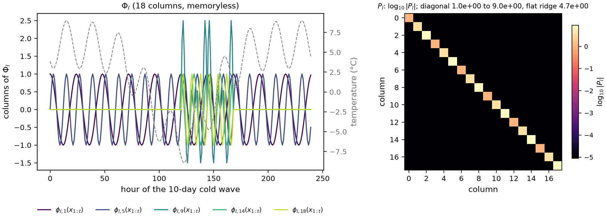

# Warped Calendar Harmonics

**Navigation:**
  * **Theory introduction:** [See the Intro](../../THEORY.md)
  * **Related code architecture:** [See the Code Architecture](../../architecture/spectrum/WARPED_CALENDAR.md)

## Diffeomorphic Phase-Warped Calendar Harmonics

During regime shifts (e.g., weekends, public holidays, or school breaks) indicated by $z_t \in \{0, 1\}$, periodic daily or annual profiles undergo both vertical amplitude scaling and horizontal phase shifts. Given base Fourier harmonics $\Phi_{\text{base}}(\tau_t) = [\cos(k \tau_t), \sin(k \tau_t)]_{k=1}^K$ on phase $\tau_t \in [0, 2\pi)$, a non-collinear second-order phase-modulation envelope $g(\tau_t) = (\tau_t - \pi)/\pi \in [-1, 1)$ produces full-rank $6K$ columns:

$$\Phi_{\text{wcal}}(\tau_t, z_t) = \Big[\, \Phi_{\text{base}}(\tau_t) \;\Big|\; z_t \, g(\tau_t) \, \partial_\tau \Phi_{\text{base}}(\tau_t) \;\Big|\; z_t \, \Phi_{\text{base}}(\tau_t) \,\Big]$$

regularized by a block-diagonal Sobolev frequency penalty $P_{\text{wcal}} = \lambda \cdot \operatorname{blkdiag}(P_{\text{base}}, \gamma_{\text{warp}} P_{\text{base}}, \gamma_{\text{amp}} P_{\text{base}})$ with weights $k^s$.

## Grouped models

When the model is grouped by the column that `wcal` reads (for example `group_col='tod'` with `wcal(tod, ...)`), that column is constant inside each group. The base harmonic columns are then constant, and the remaining columns vary only through `by`, so they add nothing that a day-type term on the same `by` column does not already span. Use `wcal` in a model that is not grouped by its input column.

## Normalized phase

Inside a model the input column is normalized to $[-1, 1]$ with the fixed range $(0, \text{period})$ (the effect is exempt from the training min/max normalization), so the phase of a step is $\tau_t = \pi\,(x_t + 1) = 2\pi\,(\text{value}\bmod\text{period})/\text{period}$ and the envelope $g(\tau_t) = (\tau_t - \pi)/\pi$ equals the normalized input $x_t$ itself. A value outside the period wraps around it (`extrapolate='periodic'`): $x \mapsto ((x + 1) \bmod 2) - 1$ for the values outside $[-1, 1]$.

## Penalty coordinates

With a regime indicator the effect has three smoothing weights, one per block (base harmonics, warp, amplitude), starting at $\lambda$, $\gamma_{\text{warp}}\lambda$ and $\gamma_{\text{amp}}\lambda$; without one it has a single weight:

$$P_{\text{wcal}} = \operatorname{blkdiag}\big(\lambda_{\text{base}} P_{\text{base}}, \lambda_{\text{warp}} P_{\text{base}}, \lambda_{\text{amp}} P_{\text{base}}\big), \qquad P_{\text{base}} = I_2 \otimes \operatorname{diag}(k^s)_{k=1}^{K}.$$

## Causality

The columns are a pointwise function of the phase and of the regime indicator: no memory, no state, no interaction between groups.

## What is new here

Phase registration and amplitude scaling of calendar profiles are classical in functional data analysis {cite:p}`ramsay2005functional`. What this effect adds:

- the **first-order linearization of a phase warp as regressors of an additive model**: the columns $z_t\,g(\tau_t)\,\partial_\tau\Phi_{\text{base}}$ make a holiday shift of the daily profile linear in its coefficients;
- the **phase-modulation envelope** $g(\tau) = (\tau - \pi)/\pi$, which removes the exact collinearity between the warp and the amplitude blocks and keeps the $6K$ columns of full rank;
- **one smoothing parameter per block**, chosen by GCV or REML.

## References

- Ramsay, James O, Silverman, Bernard W (2005). *Functional Data Analysis*. Springer. `ramsay2005functional`
- Goude, Yannig, Nedellec, Raphael, Kong, Nicolas (2014). *Local short and middle term electricity load forecasting with semi-parametric additive models*. IEEE Transactions on Smart Grid. `goude2014local`
- Wood, Simon N (2017). *Generalized additive models: an introduction with R*. chapman and hall/CRC. `wood2017generalized`
