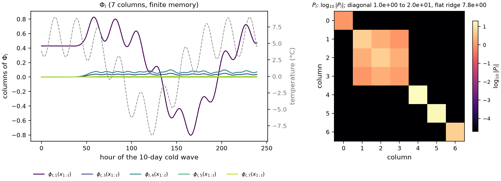

# WAVELET_SCATTERING: Translation-Invariant, Deformation-Stable Wavelet Scattering Transform (WST)

## 1. Problem Statement: High-Frequency Instability of Standard Linear Wavelets
Standard Fourier and linear wavelet representations ($W x(t, s) = x * \psi_s(t)$) suffer from structural instability under small temporal warps and non-linear deformations $x_\tau(t) = x(t - \tau(t))$ ({cite:p}`mallat2012group`). While translation invariance can be achieved by spatial averaging, linear averaging $\int x * \psi_s(t)\, dt = \hat{x}(0) \hat{\psi}(0) = 0$ annihilates all high-frequency energy.

To capture non-stationary multi-scale dynamics without losing high-frequency transient energy, Stéphane Mallat introduced the **Wavelet Scattering Transform (WST)** ({cite:p}`mallat2012group`, {cite:p}`bruna2013invariant`, {cite:p}`anden2014deep`). By cascading non-linear modulus operations $|\cdot|$ with multi-scale complex wavelet filter banks and low-pass averaging $\phi_J$, the scattering transform constructs a deterministic, contractive, Lipschitz-continuous representation that is invariant to translations and stable to diffeomorphic time warps.

---

## 2. Multi-Scale Cascaded Wavelet Scattering Operators
Let $\psi \in L^2(\mathbb{R})$ be a complex-valued analytic mother wavelet (e.g., causal Morlet) with center frequency $\xi_0$ and bandwidth $\sigma$.
Dilated bandpass wavelets at scale $j \le J$ and sub-octave frequency $q \in \{0, \dots, Q-1\}$ are defined by:

$$\psi_{\lambda}(t) = 2^{-j/Q}\, \psi(2^{-j/Q} t), \qquad \lambda = (j, q)$$

Let $\phi_J(t) = 2^{-J} \phi(2^{-J} t)$ be a low-pass averaging filter at maximum scale $2^J$.

### Order 0 (Local Mean / Trend)
$$S_0 x(t) = (x * \phi_J)(t)$$

### Order 1 (First-Order Envelope Spectrum)
$$S_1 x(t, \lambda_1) = \big( |x * \psi_{\lambda_1}| * \phi_J \big)(t)$$

The non-linear modulus $|\cdot|$ demodulates high-frequency oscillations into regular baseband variations, which are then integrated by $\phi_J$.

### Order 2 (Cross-Frequency Modulations & Inter-Scale Interference)
$$S_2 x(t, \lambda_1, \lambda_2) = \Big( \big| |x * \psi_{\lambda_1}| * \psi_{\lambda_2} \big| * \phi_J \Big)(t), \qquad \lambda_2 < \lambda_1$$

The triangular condition $\lambda_2 < \lambda_1$ (lower frequency modulation of higher carrier frequencies) preserves over 99% of second-order energy while eliminating redundant paths.

---

## 3. Explicit Primal Integration in TAM ($\Phi_{\text{wst}}$ and $P_{\text{wst}}$)

### 3.1 Primal Feature Matrix
Concatenating the low-pass, order-1, and order-2 channels along the trajectory yields the deterministic Primal design matrix:

$$\Phi_{\text{wst}}(x) = \Big[\, S_0 x(t) \;\Big|\; \big\{S_1 x(t, \lambda_1)\big\}_{\lambda_1} \;\Big|\; \big\{S_2 x(t, \lambda_1, \lambda_2)\big\}_{\lambda_2 < \lambda_1} \,\Big] \in \mathbb{R}^{T \times M_{\text{wst}}}$$

where $M_{\text{wst}} = 1 + J Q + \frac{J Q(J Q - 1)}{2}$.

### 3.2 Hierarchical Order Penalty Matrix ($P_{\text{wst}}$)
To prevent noise overfitting in high-order cross-frequency channels, TAM equips $\Phi_{\text{wst}}$ with a regularization matrix whose diagonal grows with the scattering order. Write $s_j = \lambda_j / \xi_0$ for the scale of the $j$-th wavelet ($j = 1, \dots, N_1$ with $N_1 = J Q$) and $\gamma_m = g^m$ for the order weight, where $g$ is the order-weight parameter (default $g = 4$, so that $\gamma_1 = 4$ and $\gamma_2 = 16$):

$$P_{\text{wst}} = \lambda_p \left[ \operatorname{diag}\Big( 1,\; \big\{\gamma_1\, s_{j}^{2}\big\}_{j=1}^{N_1},\; \big\{\gamma_2\,(s_{j_1}^{2} + s_{j_2}^{2})\big\}_{1 \le j_1 < j_2 \le N_1} \Big) + \begin{pmatrix} 0 & 0 & 0 \\ 0 & D_2^\top D_2 & 0 \\ 0 & 0 & 0 \end{pmatrix} \right]$$

The order-0 channel has weight $1$; an order-1 channel has weight $\gamma_1 s_j^2$; an order-2 channel has weight $\gamma_2 (s_{j_1}^2 + s_{j_2}^2)$ for each pair $j_1 < j_2$ (the order-2 block exists only when the maximal order is at least 2). The weights shrink the order-2 interaction coefficients more strongly, while the dominant first-order envelopes fit freely. In addition, the order-1 channels, ordered by octave, carry a second-difference coupling $D_2^\top D_2$, where $D_2$ is the second-difference operator of size $(N_1 - 2) \times N_1$; it is added only when $N_1 \ge 3$ and asks neighbouring octaves of the envelope spectrum to vary smoothly. The order-0 and order-2 channels are not touched by this coupling.

## Causality, filters and state continuation

In the causal form every convolution looks backward: the wavelets and the low-pass filter are one-sided, and the cascade has a finite memory of $(|\phi| - 1) + m\,(|\psi_{\max}| - 1)$ samples for order $m$. The state is exactly that many past samples of each group, `{"hist": (B, n_hist, 1)}`, so a pass that continues the training period reproduces, to rounding, the features of one pass over both. The groups are the rows of one batch and never meet. The wavelets are built in float64, with their zero mean enforced again in the dtype of the input.

## Chunk equivalence

The features of a series computed in one pass over it equal the features computed in two chunks when the second chunk starts from the terminal state of the first. Three mechanisms carry that state, and this effect uses a **window history** (the last rows of every group, which complete the windows of the next chunk) and **frozen training statistics** (constants estimated once on the training period, which a later chunk does not update). Because the state is exactly what a later row reads from the past, a forecast can continue a fitted series one chunk at a time without refitting or recomputing the past.

## What is new here

The scattering transform, its stability and the Morlet cascade are those of the cited papers {cite:p}`mallat2012group, bruna2013invariant, anden2014deep`. What this effect adds:

- the **causal one-sided cascade with an exact finite memory**, which makes the scattering coefficients a forecasting feature that can be continued past the end of the training period;
- the **order-weighted penalty with a smoothness coupling across octaves** of the first-order envelopes;
- the use of the scattering coefficients as the columns of an **additive, closed-form penalized term**.

## References

- Mallat, Stephane (2012). *Group invariant scattering*. Communications on Pure and Applied Mathematics. `mallat2012group`
- Bruna, Joan, Mallat, Stephane (2013). *Invariant scattering convolution networks*. IEEE Transactions on Pattern Analysis and Machine Intelligence. `bruna2013invariant`
- Anden, Joakim, Mallat, Stephane (2014). *Deep scattering spectrum*. IEEE Transactions on Signal Processing. `anden2014deep`
- Mallat, Stephane (1999). *A wavelet tour of signal processing*. Elsevier. `mallat1999wavelet`
